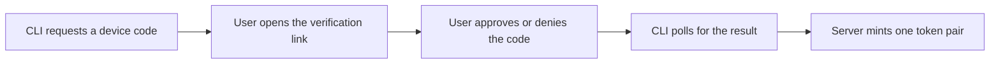

# Accounts and permissions

<!-- ste-sources
crates/starforged-core/src/accounts.rs
crates/starforged-core/src/registration.rs
crates/starforged-core/src/permission.rs
crates/starforged-core/src/tokens.rs
crates/starforged-core/src/sshkeys.rs
crates/starforged-core/src/oidc.rs
crates/starforged-core/src/totp.rs
crates/starforged-core/src/oauth.rs
-->

## Purpose

- This page describes accounts, registration, sign-in, tokens, keys, and permissions.
- It describes identity tables and rules and addresses developers and operators.

## Scope

- This page covers people and organizations in one handle space, plus sign-up, passwords, one time codes, single sign on, tokens, keys, teams, and permissions.
- It excludes browser sign-in pages and hardened server controls.
- Read those topics in [web and authentication](web-and-auth.md) and [security](security.md).

## How it works

### Identity tables

| Table | Holds |
|---|---|
| `owners` | Users and orgs. Each row holds one id and one handle. |
| `users` | Person details. The row keys to the `owners` row. |
| `orgs` | Org details. The row keys to the `owners` row. |
| `org_members` | One row per org and person, with role `owner` or `member`. |
| `teams` | One row per team, with a permission and an all-repository flag. |
| `team_members` | One row per team and person. |
| `team_repos` | One row per team and linked repository. |
| `collaborators` | One row per repository and person, with a direct permission. |

- The `owners` table enforces one namespace for handles.
- A handle belongs to a person or an org, never to both.
- `users` and `orgs` share the `owners` identifier.

### Registration and invites

Starforge supports four registration modes.

| Mode | Rule |
|---|---|
| `invite` | Only invite holders sign up. |
| `open` | Anyone signs up. |
| `domains` | Only addresses in allowed domains sign up. |
| `sso` | Password sign-up stops. Single sign on creates accounts only with `oidc.auto_create`. |

- Only site admins create invites.
- The server codes each invite with 32 random hex characters and stores its SHA-256 hash.
- The link form is `/join?invite=` plus the code.
- An invite expires 7 days after issue and serves one sign-up only.
- Sign-up claims the invite before account creation and releases it on failure.
- A successful sign-up marks the invite with the new user id.
- An address bound invite accepts only that address and marks it verified on sign-up.
- An invite without an address verifies nothing.
- With mail configured, sign-up sends a verification link to an unverified address. An unverified account can sign in without mail.
- The verification link lives for 24 hours and serves one use. A new link retires older unused links, and issue waits 5 minutes after the previous link.
- A password reset link lives for one hour. An admin reset sends a one-hour link when mail runs, else a 24-hour hand-off link.
- The server stores only the SHA-256 hash of each link secret.
- A password reset ends every web session for the account.

### Passwords and account state

- Starforge hashes passwords with Argon2id and stores only the hash.
- Single sign on accounts hold no password and password sign-in fails for them.
- An account holds state `active` or `suspended`.
- Password sign-in and token use require `active`.
- A suspended account keeps its data but loses access.

### One time codes

- Enrollment creates a 20 byte secret and stores it sealed. The settings page shows the pending entry again until confirmation.
- Each code uses 6 digits and a 30 second step.
- Verification accepts the current step and one step either way.
- The server records the last accepted step and fails a replay of the same or older step.
- Confirmation enables the factor and shows 10 recovery codes once. The server stores only SHA-256 hashes of normalized codes.
- Each recovery code serves one sign-in.
- Regeneration replaces all old codes at once.
- A challenge lasts 5 minutes and five failed codes void it.

### Single sign on

- The provider flow is authorization code with PKCE and challenge method S256.
- The server accepts only `RS256` and `ES256` identity tokens.
- The server checks issuer, audience, expiry, nonce, signature, `azp`, `iat`, `nbf`, and a non-empty subject.
- The server allows 60 seconds of clock leeway.
- The server caches discovery data for one hour and shows a generic message on failure.
- Key lookup caches keys by `kid` and refreshes once for an unknown key id.

Identity resolution follows three steps in this order:

- A linked identity matches the provider subject.
- With `link_by_email` on, a verified provider email matches one verified account email.
- Auto-create needs the `oidc.auto_create` flag and a mode that permits it. Invite mode never auto-creates.

- Auto-create makes accounts with no password.
- The server refuses a link to an identity that belongs to another account.
- The server refuses an unlink that leaves no way to sign in.

### Device flow

- Only client `starforge-cli` starts a flow.
- The response holds a device code and a short user code with the form `XXXX-XXXX`.
- The server stores only the device code hash.
- A device code expires after 900 seconds.
- The CLI polls every 5 seconds and a faster poll answers `slow_down`.
- Approval and the token grant need an active account. Approval mints one access token and one refresh token.
- The server mints the pair once through a compare and swap.
- Access tokens live 3600 seconds and refresh tokens live 90 days.

### Personal access tokens

- Tokens start with `sfp_` plus 64 hex characters.
- The server stores only the SHA-256 hash.
- A token row holds name, scopes, expiry, and last use, from 1 to 366 days.
- The user sees the secret once at creation.

| Scope | Grants |
|---|---|
| `repo:read` | Repository read through the API. |
| `repo:write` | Repository write through the API. |
| `trail:write` | Trail and change writes through the API. |
| `session:upload` | Session upload through the API. |
| `admin` | Full admin rights. |

- `repo:write` implies `repo:read`. `admin` implies every scope.

- A token with `admin` scope requires site admin rights.
- Revoke stops a token at once.
- A successful use updates the last use time.

### SSH keys and deploy keys

- The parser accepts `ssh-ed25519`, three ECDSA curves, and `ssh-rsa`.
- It rejects options prefixes, multi key input, and trailing bytes.
- RSA keys need at least 2048 modulus bits.
- A person holds at most 100 keys.
- A repository holds at most 50 deploy keys.
- Deploy keys apply to one repository only.
- Only `Admin` on the repository adds a deploy key and archived repositories refuse new deploy keys.
- A read only deploy key grants `Read` and a read write deploy key grants `Write`.

### Permission model

Five levels exist in order from low to high.

| Level | String |
|---|---|
| Read | `read` |
| Triage | `triage` |
| Write | `write` |
| Maintain | `maintain` |
| Admin | `admin` |

- The server computes one effective level per request.
- The repository owner and the org owner hold `Admin`.
- A site admin holds `Admin` everywhere.
- Other viewers take the maximum of org base, covering teams, and collaborators. The org base permission is `none`, `read`, or `write`.
- Org base `none` adds no grant.
- A team covers one repository or all repositories.
- Public repositories give anonymous readers `Read` and internal repositories give signed in readers `Read`.
- Membership means one explicit grant.
- Implicit visibility read never counts as membership.
- Site admin rights alone never count as membership.

### Account deletion

- Deletion asks the user to type the handle and fails with non deleted repositories.
- The last active admin cannot delete the account.
- The last org owner cannot delete the account.
- Deletion revokes tokens and web sessions first.
- Uploaded sessions delete in small batches.
- Deleted repositories purge at once.
- Collaborator grants go with the account.
- The `owners` row delete cascades to the `users` row.
- Audit rows stay with the actor reference cleared.

## Interfaces

| Area | Entry point |
|---|---|
| Registration | `Core::sign_up` |
| Invites | `Core::create_invite` |
| Single sign on | `Core::oidc_finish` |
| Device flow | `Core::create_device_code` |
| Tokens | `Core::create_token` |
| SSH keys | `Core::add_ssh_key` |
| Permissions | `permission::effective` |
| Account deletion | `Core::delete_account` |

- The sign-in and join pages write to `/login` and `/join`.
- Single sign on ends at `/login/oidc/callback`.
- Device approval lives at `/oauth/device`.
- Identity links live at `/settings/identities`.

## Failure behavior

- An unknown, used, revoked, or expired invite fails with one message.
- Sign-in applies the per-IP and per-account rate limits. OIDC sign-in shares them.
- Unknown accounts verify against a dummy hash.
- Wrong passwords fail with the same error as unknown accounts.
- A suspended account fails password sign-in.
- A failed identity token shows a generic message.
- An unknown, revoked, expired, or suspended token fails as unauthenticated.
- An unknown device client id or SSH fingerprint fails with a generic message.
- A hidden repository and admin pages answer `404` for non admins.
- An admin cannot suspend or delete the last active admin.
- An admin cannot delete or suspend the self account.
- Removal or demotion of the last owner fails.

## Verification

- Unit tests cover invites that serve one sign-up and release on failure.
- Unit tests cover permission matrices and membership rules.
- Unit tests cover token scopes, device mint once behavior, time based vectors, and key parsing.
- Run `python3 scripts/ste_check.py docs/technical/accounts-and-permissions.md` after every edit to this page.

## Related

- [security](security.md): trust boundaries and hardened controls.
- [web and authentication](web-and-auth.md): browser pages and web sessions.
- [single sign on and two factor setup](../admin/sso-and-2fa.md): provider setup.
- [orgs and teams](../user/orgs-and-teams.md): day to day org use.
