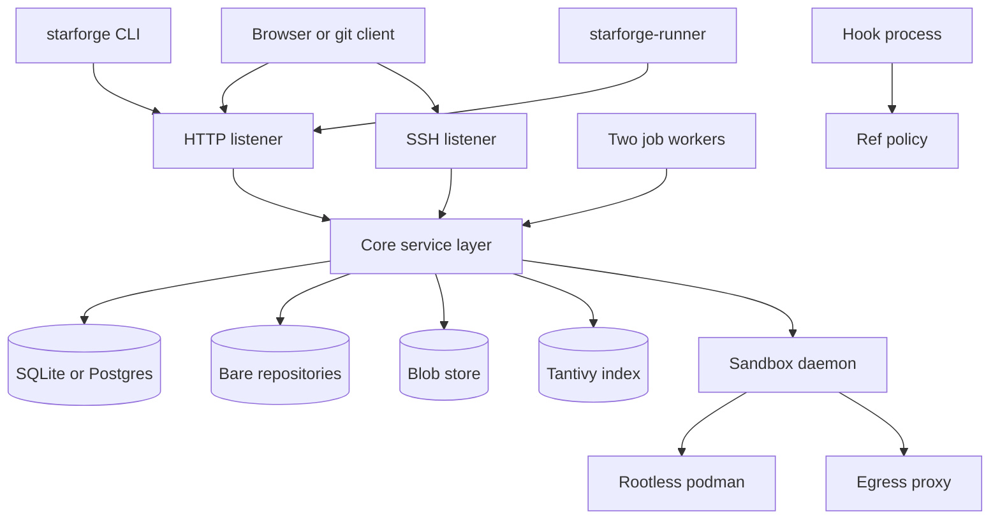

# Architecture

<!-- ste-sources
Cargo.toml
crates/starforged/src/lib.rs
crates/starforged/src/main.rs
crates/starforged/src/serve.rs
crates/starforged/src/admin.rs
crates/starforged/src/hook.rs
crates/starforged-core/src/lib.rs
crates/starforged-core/src/jobs.rs
crates/starforged-web/src/lib.rs
crates/starforged-api/src/lib.rs
crates/starforged-ssh/src/lib.rs
crates/starforged-db/src/lib.rs
crates/starforged-git/src/lib.rs
crates/starforged-blob/src/lib.rs
crates/starforged-index/src/lib.rs
crates/starforge-runner/src/lib.rs
crates/starforge-sandbox-protocol/src/lib.rs
crates/starforge-sandboxd/src/lib.rs
crates/starforged-core/src/ci.rs
crates/starforged-core/src/sandboxes.rs
crates/starforged-core/src/ci_usage.rs
-->

## Purpose

This page describes the Starforge process model and the request paths.
The server program has the name `starforged`.
The client program has the name `starforge`.

## Scope

This page covers the runtime shape of one deployment.
It does not cover configuration keys in detail.
The [configuration page](configuration.md) covers those keys.
It does not cover schema details in detail.
The [storage and database page](storage-and-database.md) covers that schema.

## Design

`starforged` runs as one tokio process.
The process owns one HTTP listener.
The process owns one optional SSH listener.
The process owns two job workers.
`JOB_WORKERS` equals two in `crates/starforged/src/serve.rs`.
No separate worker process exists.

Jobs live in `starforged-core`.
The workers run inside the server process.

The CI control plane lives in `starforged-core`.
The `ci` module owns runners, runs, jobs, artifacts, and CI secrets.
The `sandboxes` module owns the sandbox control plane.
The `ci_usage` module meters native runner use.
Depot usage comes from Depot through `ci_usage_depot`.
The control plane never enforces Depot limits.

The binary entry point lives in `crates/starforged/src/main.rs`.
`main` parses command line arguments with `Cli::parse`.
The `serve` command calls `serve::run`.
The `hook` command calls `hook::pre_receive`.
Other commands use `admin::open_core` without a server.



The layer rule separates the crates.
`starforged-web` and `starforged-api` call `Core`.
`Core` is the only path to stored state on the request path.
On the request path, only `Core` opens the database.
On the request path, only `Core` opens the search index.
On the request path, only `Core` reads blob bytes.

The binary's admin commands open the database or index directly.
Backup, restore, and doctor read stored state without a request.
Request handlers do not spawn git commands. `Core` does.
The hook process spawns git read commands and never opens the database.

Startup follows a fixed order.
`serve::run` first checks the git version.
`starforged_git::command::check_version` aborts on failure.
`serve::build` then validates the configuration.
`Config::validate` rejects bad values before any connection.

`admin::open_core` then connects the database.
`Db::connect` uses `database_url` from the configuration.
`Db::migrate` runs when `database.auto_migrate` is true.
`Core::new` receives the database and derived paths.
The router build then merges web, API, and operations routes.
`recover_search_index` enqueues a rebuild after recreation.

`jobs::start_workers` then spawns the two workers.
The HTTP bind then opens the TCP listener.
The SSH start then opens the SSH listener when enabled.
SSH starts before the HTTP serve loop begins.

Each job worker sweeps CI jobs when a sweep is due.
The sweep interval is 30 seconds.
The sweep requeues jobs with expired leases.
The sweep fails jobs past deadline plus a 60 second grace period.

Shutdown uses one signal future.
`shutdown_signal` listens for ctrl-c.
`shutdown_signal` also listens for SIGTERM on Unix.
HTTP drains gracefully on shutdown.
`serve_on` uses `with_graceful_shutdown`.
SSH waits on the same shutdown signal.

Whichever listener finishes first ends the process.
The runtime spawns detached worker tasks.
Workers do not join on shutdown.
In-flight jobs return to the queue through lease expiry.

## Interfaces

`starforged-web` serves HTML pages and git smart HTTP.
`starforged-web::router` builds those routes.
`starforged-api` serves the JSON REST API.
`starforged-api::router` nests under `/api/v1`.
The operations routes live in `serve::build`.
`GET /healthz` returns `ok` without checks.

`GET /readyz` returns 200 or 503 with failing names.
`GET /metrics` returns Prometheus text or 404 without a token.
`starforged-ssh::serve` runs the git SSH listener.
`starforge` serves the client side only.
The client never embeds the server.

An HTML page request enters the HTTP listener.
The web layer authenticates the web session.
The web layer calls `Core` methods.
`Core` reads the database, git data, or index.
The web layer renders the response.

A REST call enters the HTTP listener.
The API layer authenticates the token or OAuth grant.
The API layer checks scopes and rate limits.
The API layer calls `Core` methods.
`Core` performs the state change.
The API layer renders the JSON envelope.

A git push over smart HTTP enters `starforged-web::githttp`.
`authorize` checks identity against `Core::git_access`.
The layer snapshots ref tips before the push.
The layer spawns `git receive-pack` in the bare repository.
The receive-pack process runs the pre-receive hook.
The hook process reads the policy snapshot from environment variables.

The hook checks every pushed ref with `refpolicy`.
The hook exit code decides acceptance.
After success, a background task scans pushed changes.
The scan reads session trailers in pushed commits.
The scan creates changes from `refs/for` lines.
The scan enqueues `GitMaintenance` for the repository.

A git push over SSH enters `starforged-ssh`.
The SSH layer authenticates the public key.
The same `Core::git_access` check authorizes the push.
The SSH layer spawns `git receive-pack` the same way.
The hook and post-receive scan then follow the HTTP path.

A session upload enters `starforged-api`.
The route accepts one segment body.
`Core` checks quotas and redaction rules.
`Core` writes the segment bytes to the blob store.
`Core` inserts the session and segment rows.
`Core` enqueues index jobs for the new segment.

A CI run enters `starforged-api`.
The runner registers with a runner token.
The runner long-polls for a job with `POST /runners/jobs/request`.
The server claims the job under a fence token.
The runner mints a short-lived git credential.
The runner creates a sandbox through the sandbox API.

The runner runs job commands in the sandbox.
The runner streams log bytes with `Content-Range`.
The runner sends a heartbeat every 30 seconds.
The runner finishes with state, exit code, checksum, and session identifiers.
A stale fence returns 409 and stops the runner.
A canceled job kills the sandbox and stops the runner.

The sandbox daemon is a separate process.
The daemon listens on a Unix socket.
The socket path comes from `sandbox.local.socket`.
The server sends a bearer token from `sandbox.local.token_file`.
The daemon runs containers with rootless podman.
The daemon also runs sandboxes with `gvisor` on request.

Each sandbox gets one egress proxy task.
The proxy denies all egress by default.
The proxy allows only `sandbox.local.egress.allowlist` hosts.
The proxy terminates TLS with a per-sandbox CA.
The proxy injects secret headers for allowlisted hosts.
Secret values never enter the sandbox.

The sandbox keeps `--network none`. The daemon mounts a per-sandbox egress directory and starts an in-sandbox forwarder. The forwarder listens on `127.0.0.1:3128` and creates a Unix socket. The host daemon connects into that socket with a connection pool. The proxy enforces the allowlist for proxied traffic.

## Failure behavior

Invalid configuration stops startup.
A bad TOML file stops startup.
A failing database connect stops startup.
A failing migration stops startup.
A failing HTTP bind stops startup.
A failing git version check stops startup.

The process exits non-zero in each case.
No partial serving occurs after a fatal error.

The search index never stops startup.
`Core` falls back to a throwaway index on open failure.
`recover_search_index` only logs enqueue failures.
The server starts with a rebuild job queued.

Push side effects stay best effort.
The receipt of maintenance and scan enqueue errors only logs.
A failed snapshot disables the trailer scan for one push.
The job queue retries failures with backoff.
A lease expiry requeues in-flight jobs after a crash.

## Verification

`crates/starforged/tests/observability.rs` covers health and metrics routes.
`crates/starforged/tests/init_cli.rs` covers config generation and file modes.
`crates/starforged/tests/mail_cli.rs` covers queued mail delivery.
`crates/starforged/tests/backup_restore.rs` covers consistent snapshots.
`crates/starforged/tests/web_push.rs` covers push side effects.
`crates/starforged-core/src/jobs.rs` covers job retry and lease behavior.

Run the checker in the working directory:

```bash
python3 scripts/ste_check.py docs/technical/architecture.md
```

## Related

- [crates documentation](crates.md)
- [configuration documentation](configuration.md)
- [storage and database documentation](storage-and-database.md)
- [git hosting documentation](git-hosting.md)
- [operations documentation](operations.md)
- [web and auth documentation](web-and-auth.md)
- [http api documentation](http-api.md)
- [CI and sandboxes](ci-and-sandboxes.md)
