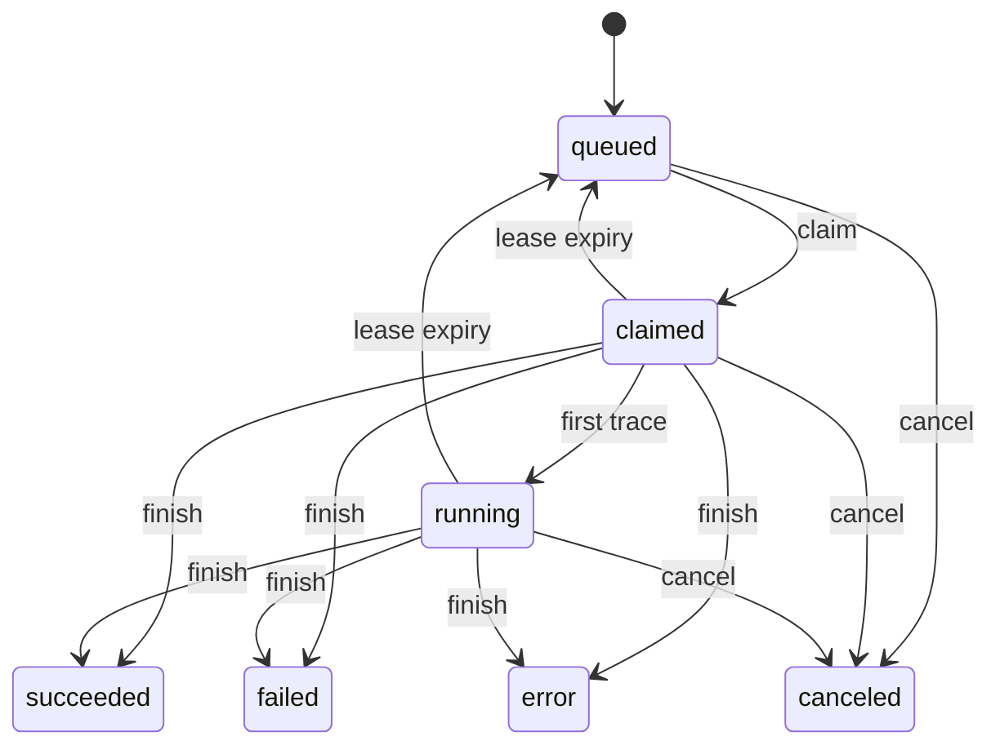

# CI and sandboxes

## Purpose

Milestone M6 adds opt-in continuous integration. A repository opts in with one file named `.starforge/ci.toml`. A registered runner claims each job and runs it in a sandbox. A sandbox can also run outside CI. The server counts and limits native runner time. A linked Depot repository reports its own use.

## Scope

The code in `starforge-ci-spec/src/lib.rs` parses the spec.
The code in `starforged-core/src/ci_spec.rs` re-exports it.

The code in `starforged-core/src/ci.rs` owns runners, jobs, artifacts, secrets, and session capture. The code in `starforged-core/src/ci_usage.rs` and `ci_usage_depot.rs` builds the usage report. The code in `starforged-core/src/sandboxes.rs` and `sandboxes_e2b.rs` owns sandbox providers. The code in `starforge-sandboxd/src/podman.rs` and `proxy.rs` owns the local daemon. The code in `starforge-runner/src/lib.rs` owns the runner.

## How it works

### Spec file and triggers

The spec lives at `.starforge/ci.toml` in the commit tree. `read_ci_spec_at_commit` reads the blob from the commit tree. It never reads the working tree. An empty result means that the commit carries no spec. A malformed spec returns `Invalid`. A known creator triggers a `ci/spec` error check.

`CiSpec::parse` validates the document. The version must equal `1`. Unknown fields fail at every level. The file holds at most 256 KiB. The file holds at most 100 jobs. Each job sets exactly one of `image` or `template`.

Each job holds at least one command. When a job sets no timeout, the timeout defaults to 1 hour. The maximum timeout equals 4 hours.

Trigger `push` holds branch globs. Trigger `trail` holds `opened` or `updated`. Two empty trigger lists mean manual-only runs.

A post-receive scan calls `ci_trigger_push_scan` after every successful push. A push to a matching branch calls `ci_trigger_push`. `ci_trigger_manual` starts a manual run. A push to `refs/for` calls `ci_trigger_trail`. Revision 1 uses action `opened`. Later revisions use action `updated`.

A pusher, a Trail author, or a manual caller becomes the job creator.

One active job covers each triple of repository, commit, and job name. `enqueue_ci_job` deduplicates on that triple. A re-trigger of the same commit enqueues no duplicate. Pushes never supersede old jobs. A new Trail revision supersedes old jobs of its change. Supersede cancels each active queued, claimed, or running job of an older revision.

### Job lifecycle and states

A job row moves through seven states. The states are `queued`, `claimed`, `running`, `succeeded`, `failed`, `error`, and `canceled`. The first three states describe work that a runner owns. The last four states describe end results. `finish_ci_job` accepts only `succeeded`, `failed`, or `error`.

A runner long-polls the request endpoint with a wait of up to 50 seconds. `claim_ci_job` claims the oldest due job of the runner repository. Each claim mints a fresh lease fence. The fence travels in the `X-Starforge-Fence` header. `CLAIM_LEASE_SECS` sets the lease length at 60 seconds. The deadline starts at claim time.

The deadline adds the job timeout to the claim time. The claim also mints a per-job token. The token expires at deadline plus 600 seconds. A claim that finds a label mismatch releases the job back to `queued`. One claim request tries at most 10 claims. An unparseable spec follows the same release path.

`trace_ci_job` moves a claimed job to `running`. Each trace renews the 60-second lease. The runner heartbeat also renews the lease. `heartbeat_ci_job` answers 409 for a stale fence. The runner sends a heartbeat every 30 seconds. A quiet command cannot let the lease expire.

`HEARTBEAT_SECS` is 30. A stale fence answers `FenceMismatch`. A canceled job answers `Canceled`.

Job workers run `run_ci_sweep_if_due` once per 30 seconds. `sweep_ci_jobs` handles expired leases and passed deadlines. An expired lease returns the job to `queued` while attempts remain. `CI_MAX_ATTEMPTS` sets the attempt limit at 3. A job at the attempt limit ends as `failed`. A job past its deadline by 60 seconds ends as `failed`.

`CI_DEADLINE_GRACE_SECS` sets that grace at 60 seconds. The sweep ends a reaped attempt at its lease end. The sweep revokes the job token and the git credential. A terminal check is never overwritten by a later runner report.

A cancel for a queued job ends the job at once. A cancel for a claimed or running job requests a cancel. `cancel_ci_job` writes the terminal check at request time. The runner acknowledges the cancel on its next trace or finish call. Cancel wins over a late trace. Cancel wins over a late finish.

The description reads `canceled by <user>`. Supersede writes the description `superseded by a newer revision`. Revocation of a runner releases its jobs back to `queued` and records usage.

### Checks and webhook event

Every job writes one check named `ci/<job-name>`. Enqueue writes the check with state `pending`. `finish_ci_job` maps `succeeded` to `success`. The same map sends `failed` to `failure`. The same map sends `error` to `error`. A cancel writes state `error`.

A supersede writes state `error`. A lease expiry with attempts left writes no check. A lease expiry at the attempt limit writes state `failure`. The description reads `the runner stopped before finishing`. A timeout writes the description `the job exceeded its timeout`. Gates can require a `ci/<job-name>` check exactly like an external context.

The server emits the `ci` webhook for each transition. The actions are `queued`, `started`, `finished`, and `canceled`. The subject holds the job id, the job name, and the commit SHA. The subject also holds the state, the runner id, the exit code, and the creator. The `check` webhook still reports status transitions. The `check` subject carries the `ci_job_id` for one native status.

The full payload description lives in the [CI format reference](../format/ci-v1.md).

### Artifacts and job credentials

A runner harvests files that match the job artifact globs. A file name stays relative and holds no `..` entry. `authorize_artifact_upload` binds one token to the job, the name, the size, and the SHA-256. The token prefix reads `sfa_`. The token expires in 10 minutes.

`upload_ci_artifact` checks the bytes against the bound SHA-256. The token is one-time use. A replay answers `Conflict`. Each artifact caps at 1 GiB. Each artifact expires after 30 days. The hourly cleanup deletes expired artifact rows and zero-ref blobs.

The runner initializes the checkout in place with `git init` and `fetch` because `/workspace` already holds the per-sandbox CA directory.

The hourly cleanup runs `gc_expired_artifacts`. It deletes expired artifact rows. It deletes a blob when no unexpired artifact references it.

The blob store keeps the bytes under a BLAKE3 address. Downloads need an artifact token or the job token.

The sandbox file API has a text route and a binary route at `/sandboxes/{id}/files/raw`. The runner reads and writes cache archives through the raw route in 8 MiB chunks, which matches the daemon's per-file cap.

### Dependency cache

A job can declare `[job.cache]` with an exact key, up to 8 relative paths, and up to 4 restore prefixes. The server keys entries by `(repository, branch scope, key)`. A job reads its own scope, then the default branch's, and writes only its own. The runner restores the entry before the commands and saves it after a successful job. `put_ci_cache` stores the archive in the same blob store and upserts one `ci_cache_entries` row per `(repository, key)`. An entry caps at 256 MiB and expires after 7 days.

A repository keeps at most 50 live entries. A save evicts the least recently used entries first and then checks `cache_bytes`. `gc_expired_caches` runs in the hourly cleanup.

The runner fetches one short-lived git credential per job. `git_credential_for_runner` mints one `sfp_` token. The token scope holds `repo:read` and `repo:write`. The token expires at the earlier of the deadline and now plus 1 hour. The server revokes the token at finish or cancel.

### Session capture inside jobs

A job runs agent commands in the sandbox. The runner puts the per-job token in `STARFORGE_TOKEN` in the sandbox environment. The runner sets the `starforge.server` and `starforge.repo` git settings in the checkout.

The runner runs `starforge sync` in the sandbox. The sync uses the per-job token from the environment. The sync uses the `starforge.server` and `starforge.repo` git settings. No interactive sign in occurs. No long-lived token enters the sandbox.

`finish_ci_job` links each uploaded session to the job. It also links every session whose `ci_job_id` matches the job, so a missed sync-output ULID does not hide a session. The run page lists those sessions.

`redact_ci_secrets` replaces secret values with `[redacted]`. It covers base64 forms, URL forms, hex forms, and JSON escaped forms. `redact_ci_secrets_with_history` covers values split across a segment seam. No stored segment, page, preview, or index entry keeps the value.

### Secrets

`create_ci_secret` seals each secret value. `CiSecretBox` uses XChaCha20-Poly1305. The server derives the key with HKDF under the domain `ci-secrets-v1`. The sealed form carries the prefix `c1:`. The database, the audit log, and the logs never receive the plain value.

`resolve_runner_job_secrets` resolves the secret names of one claimed job. The runner owns the claim and presents the fence. The returned values exist in memory only. After the git credential, the runner calls `POST /api/v1/runners/jobs/{id}/secrets` with its fence. The runner adds resolved values to its log-scrub list. A stale fence or a not-found answer aborts the job.

A repository admin sets two per-repository policies. `ci_allow_secrets_on_refs_for` opts a repository in to secret trust on `refs/for` runs. `ci_env_secrets` opts a repository in to secret delivery as environment variables on the E2B provider only. Both policies default to off. A repository admin changes them with `PATCH /api/v1/repos/{owner}/{repo}`.

`create_sandbox_for_job` resolves the secret names of one job. `secrets_trusted_for_job` gates the resolution. A non-`refs/for` job resolves secrets only when the reviewer's latest review of the job's own revision is an approval. An approval of an earlier revision does not carry over.

A name present with a false trust result returns `Invalid` with `repository secrets are not available to this run`. A missing name returns `Invalid` with `secret NAME does not exist for this repository`. An unbound secret returns `Invalid` with `secret NAME has no host binding`.

Each secret carries an optional `host` and an optional `header` binding. `host` defaults to empty. `header` defaults to `Authorization`. The host is an exact DNS name. The header is a safe request header.

An empty host means no proxy injection. The secret still registers for session redaction.

For a job-token sandbox create, the server resolves the job secrets itself. The server records the resolved secrets in `ci_job_secrets`. The server sends host, header, and value bindings to the local daemon over the Unix socket. The daemon injects a value only when the request `secret_headers` names the same host and the same header.

The proxy injects a value only when the inner request `Host` matches the bound host. The proxy also checks the authority of an absolute form request. A mismatch answers `403`.

Secret values never enter the sandbox environment or filesystem on the local provider. On the E2B provider only, a repository with `ci_env_secrets` set injects values as environment variables.

`secrets_trusted_for_job` applies the trust rule. A job trusts secrets only on a protected branch or an approved Trail. A `refs/for` run trusts secrets only when the repository opts in with `ci_allow_secrets_on_refs_for`.

The egress proxy injects the value as a header for an allowlisted host. Each secret row also holds a redaction flag. Dynamic redaction uses the values of redaction-enabled resolved secrets.

### Sandboxes

One trait `SandboxProvider` covers every provider. The `local` provider talks to `starforge-sandboxd` over a Unix socket. The daemon reads its token from a mode `0600` file. The token file rotates on restart. The daemon runs rootless podman containers.

Runtime `podman` is the default. Runtime `gvisor` selects `runsc` on request. The table `sandbox_runtimes` reports `podman`, `gvisor`, and `e2b` as available. It reports `firecracker` and `kata` as reserved. A create that names `firecracker` or `kata` returns 422.

The `e2b` provider talks to the real E2B v2 API over HTTPS. The control plane is `POST /v2/sandboxes` and the lifecycle routes on `api.e2b.app` with `X-API-Key`. The data plane is envd on `sandbox.e2b.app` with the per-sandbox `E2b-Sandbox-Id`, `E2b-Sandbox-Port`, and `X-Access-Token` headers.

Exec uses the Connect protocol. The method is `process.Process/Start`. Files use the envd file and filesystem routes. The API key never reaches logs.

Each sandbox gets its own egress proxy task. The proxy terminates TLS under a per-sandbox CA. The CA name constraints cover only allowlisted destinations. The proxy resolves each DNS name once and pins the answer. The proxy injects a secret header only for a bound host and a matching `Host`. The proxy answers `403` when the `Host` does not match.

A `host:port` entry permits exactly that port. A bare `host` entry permits ports 80 and 443 only. The proxy forwards HTTPS `CONNECT` and absolute-form plain HTTP.

The proxy refuses a non-allowlisted host. The CA keys carry mode `0600`. The daemon destroys the CA with the sandbox. The daemon refuses host mounts and privileged containers. The server rejects a secret header host outside the allowlist.

The sandbox keeps `--network none`. The daemon mounts the per-sandbox egress directory at `/run/starforge/egress` with the `:Z` option. It copies its own binary into `/workspace/.starforge-proxy/sandboxd` and starts `forward` detached. The forwarder listens on `127.0.0.1:3128` for sandbox clients and creates the Unix socket `/run/starforge/egress/shim.sock`. The host daemon connects into that socket with a pool of four idle connections. The forwarder pairs each sandbox TCP client with one pooled host connection.

SELinux denies a container process connecting to a host-owned socket. The host can connect to a socket the container creates. The daemon must be a static binary because it runs inside the sandbox.

The sandbox sets `HTTP_PROXY`, `HTTPS_PROXY`, `http_proxy`, and `https_proxy` to `http://127.0.0.1:3128`. The proxy forwards HTTPS `CONNECT` and absolute-form plain HTTP to allowlisted hosts. The daemon can add a private HTTPS port with `--egress-https-port`. A non-allowlisted host or port answers `403`. A sibling sandbox cannot reach another sandbox's forwarder socket.

After DNS resolution the proxy dials only addresses that pass the policy. The proxy refuses loopback, private, link local, CGNAT, multicast, reserved, and unique local addresses. The proxy also refuses IPv4 mapped forms of these addresses. The proxy refuses these addresses even for an allowlisted name or IP literal. The forge `host:port` and the operator ranges form the only exceptions.

The daemon flag `--egress-allow-cidr CIDR` is repeatable. The operator allows one special use range per flag.

`create_sandbox_for_job` adds the forge `host:port` from `server.base_url` to the network policy `forge` entry. The server declares this value per job sandbox. The port defaults by scheme. The forge entry lets a job reach the whole forge service on that port, on any path. The runner checks out the job commit in place and fetches with the credential URL without storing it in git config.

The daemon removes the workspace volume with the sandbox. The daemon sets `SSL_CERT_FILE`, `NODE_EXTRA_CA_CERTS`, and `GIT_SSL_CAINFO` to the per-sandbox CA. The daemon trusts a private upstream CA with `--egress-upstream-ca`. Secret values never enter the sandbox. With egress disabled, the container stays with `--network none`.

Sandbox limits answer 429 for a limit breach. `max_concurrent_per_user` caps concurrent sandboxes per user. `max_concurrent_per_repo` caps concurrent sandboxes per repository. `sandbox_seconds_per_hour` caps seconds per user per hour. `default_ttl_secs` records the default lifetime at 3600 seconds. A request can set its own `timeout_s`.

The daemon enforces each sandbox TTL.

### Usage and quotas by supplier

Two suppliers report for one repository. The `native` supplier reports Starforge runner use. The `depot` supplier reports Depot use. Each report names the limits it can see as `limit`. A null `limit` means no visible limit.

### Native metering and enforcement

`record_attempt_usage` writes one `ci_usage` row per job and attempt. A unique key on the job and the attempt keeps the write idempotent. The transition that ends an attempt records the row. A finish records the row. A cancel records the row. A runner revocation records the row.

A reaped attempt ends at its lease end. An overdue attempt ends at sweep time. The row records `claimed_at` as the start. The row records the end time as the end. Seconds equal end minus start.

`[ci.limits]` caps native use. `minutes_per_month` caps runner minutes per repository per UTC calendar month. `artifact_bytes` caps unexpired artifact bytes per repository. `cache_bytes` caps live cache bytes per repository. A zero value disables the cap. The server checks the minutes cap at queue time.

A refused run skips job creation and skips the `ci` event. A refused run writes an `error` check unless the commit already holds that check. The description names the reset date. A manual trigger answers `Invalid`, and the API maps `Invalid` to 422.

Authorize time checks the artifact cap. Upload time checks it again.

### Depot metering without enforcement

A repository admin links the repository by writing its Depot name. The name uses the form `owner/name`. The endpoint is `PUT /api/v1/repos/{owner}/{repo}/ci/suppliers/depot`. `ci_usage_depot.rs` calls the Depot Connect service `UsageService/GetUsage`. The adapter sends the organization token as a bearer token.

The API returns no limits. Each Depot metric so reports `limit` as null. The report sets `enforced_by` to `depot`. Starforge never blocks Depot work. If Depot is unreachable, the Depot report carries an `error` and the native report stays correct.

### Report endpoints and page

`ci_usage` serves the native report. `GET /api/v1/repos/{owner}/{repo}/ci/usage` serves every supplier report. Each report lists `used` for every metric. Each report lists `limit` only when Starforge can see one. Native metrics are `runner_minutes`, `attempts`, `artifact_bytes`, and `cache_bytes`.

Depot metrics are `depot_ci_vcpu_minutes`, `depot_ci_minutes`, `depot_ci_attempts`, `github_actions_minutes`, and `github_actions_jobs`. The page `/{owner}/{repo}/ci/usage` shows the same reports. The page needs at least Maintain. The runs page also links to the usage page.

## Interfaces

`CiSpec::parse` and `read_ci_spec_at_commit` handle the spec. `ci_trigger_push`, `ci_trigger_trail`, and `ci_trigger_manual` start runs. `claim_ci_job`, `trace_ci_job`, `heartbeat_ci_job`, and `finish_ci_job` drive the runner protocol. `cancel_ci_job` requests a cancel. `sweep_ci_jobs` reaps expired leases and missed deadlines.

`run_ci_sweep_if_due` gates the sweep by time. `authorize_artifact_upload` and `upload_ci_artifact` move artifacts. `git_credential_for_runner` mints the git credential. `resolve_runner_job_secrets` returns in-memory secret values. `create_ci_secret` seals a secret value. `set_ci_secret_policy` stores the per-repository opt-ins.

`redact_ci_secrets` and `redact_ci_secrets_with_history` redact session text. `create_sandbox` and `sandbox_runtimes` drive sandboxes. The HTTP routes live in `starforged-api/src/sandboxes.rs` and `starforged-api/src/ci.rs`. The CI runs page lives in `starforged-web/src/pages/ci.rs`. Route and scope detail lives in [HTTP API conventions](http-api.md).

## Failure behavior

A malformed spec writes a `ci/spec` error check and fails the trigger. A job with no matching runner stays queued. A label mismatch returns the job to `queued`. A stale fence answers 409 on trace, finish, and heartbeat. A cancel wins over a late trace and over a late finish. A reaped job drops its credentials at once.

The sweep never sends a check for a job that returns to `queued`. Resolve skips a missing secret name. An untrusted `refs/for` run resolves no secret value. An artifact replay answers `Conflict`. An artifact with a wrong hash answers `Invalid`. An artifact past the storage cap answers `Invalid`.

A sandbox create that names `firecracker` or `kata` answers 422. A sandbox create past a limit answers 429 with `Retry-After`.

## Verification

Unit tests cover `CiSpec::parse` and every cap. The test names hold validation cases for each field. The seal test proves a round trip and proves that `Debug` redacts the key. The redaction tests prove every variant and every seam split.

The `GetUsage` tests decode a fixture response and record each request. Integration tests cover the full job lifecycle and the sweep. The test `api_ci_jobs.rs` exercises the runner routes. The `db_ci` tests prove idempotent usage rows and reap timing. The suites cover the network path, the bindings, the per-repository policy, and artifact GC.

The E2B tests record each HTTP request against a fake server. Run the core, API, and DB suites after a lifecycle change.

## Related

- [Trails and gates](trails.md)
- [Webhook events](webhooks.md)
- [HTTP API conventions](http-api.md)
- [Agent sessions](sessions.md)
- [Operations and jobs](operations.md)
- [User CI guide](../user/ci.md)
- [CI administration](../admin/ci.md)
- [CI format reference](../format/ci-v1.md)

<!-- ste-sources
crates/starforged-core/src/ci.rs
crates/starforged-core/src/ci_spec.rs
crates/starforged-core/src/ci_usage.rs
crates/starforged-core/src/ci_usage_depot.rs
crates/starforged-core/src/repos.rs
crates/starforged-core/src/sandboxes.rs
crates/starforged-core/src/sandboxes_e2b.rs
crates/starforged-core/src/webhooks.rs
crates/starforged-core/src/jobs.rs
crates/starforged-api/src/ci.rs
crates/starforged-api/src/ci_auth.rs
crates/starforged-api/src/repos.rs
crates/starforged-api/src/sandboxes.rs
crates/starforged-db/src/ci.rs
crates/starforged-db/src/repos.rs
crates/starforged-db/src/sandboxes.rs
crates/starforge-runner/src/lib.rs
crates/starforge-sandbox-protocol/src/lib.rs
crates/starforge-sandboxd/src/main.rs
crates/starforge-sandboxd/src/podman.rs
crates/starforge-sandboxd/src/proxy.rs
crates/starforged-web/src/pages/ci.rs
-->
