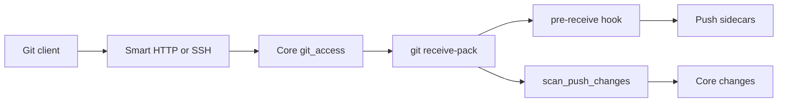

# Git hosting

## Purpose

This page explains how Starforge hosts git repositories. It covers Smart HTTP, SSH transport, ref policy, push hooks, and merge.

Read this page with [trails.md](trails.md). Trails describe collaboration objects. This page describes git mechanics.

## Scope

The code in `starforged-git` runs git processes. The code in `starforged-core` decides access. The HTTP layer lives in `githttp.rs`. The SSH layer lives in `starforged-ssh`.

The `pre-receive` hook lives in `hook.rs`. The hook never opens the database.

## How it works

### Smart HTTP

Smart HTTP serves three routes under the repository path. `info_refs` serves ref advertisement. `upload_pack` serves fetch. `receive_pack` serves push.

The function `authorize` authenticates each request. It reads the `Authorization` header. It accepts HTTP Basic auth. The username carries no meaning. The password carries a personal access token. `basic_password` extracts the password from the header.

The function `authorize` then calls `Core::git_access`. `git_access` strips the `.git` suffix. It resolves the repository. It returns `GitAccess` with the write tier flag.

Anonymous callers can fetch public repositories. Anonymous receive-pack requests return `Unauthenticated`. Git clients then prompt for credentials. Archived repositories refuse receive-pack with `403`.

Anonymous callers get `401` for unknown or unreadable repositories. Authenticated callers get `404`. The answer reveals no existence to a caller without access.

`advertisement` runs `git upload-pack` or `git receive-pack` with `--stateless-rpc` and `--advertise-refs`. Protocol versions 0 and 1 carry a `# service=` pkt-line preamble. Protocol version 2 carries no preamble. `advertisement` and `spawn_rpc` pass `GIT_PROTOCOL` from the request header.

`rpc_env` advertises push options on receive-pack. Upload-pack hides `refs/for` and `refs/trails`. Upload-pack sets `allowTipSHA1InWant` to true. Receive-pack hides nothing. Hidden refs deny receive-pack updates. Visible refs stay pushable.

`spawn_rpc` runs `git upload-pack` or `git receive-pack` with `--stateless-rpc`. `request_reader` gunzips gzip request bodies. The child process streams stdout as `application/x-git-...-result`.

### SSH

The SSH server accepts `git-upload-pack`, `git-receive-pack`, and `git-upload-archive` only. `parse_exec` rejects every other command. The handler calls `Core::git_access` with the same rules. User keys carry full token scope. Deploy keys bind to one repository ID. Deploy keys never reach another repository.

The SSH server reuses `Core::git_rpc_env`. Pushes over SSH carry the same environment as pushes over HTTP. The `pre-receive` hook enforces the same policy.

### Ref policy

The table below lists the accepted ref namespaces.

| Ref namespace | Rule |
|---|---|
| `refs/heads/*` | Branch push needs write tier plus `repo:write` scope |
| `refs/tags/*` | Tag push needs write tier plus `repo:write` scope |
| `refs/for/<base>` or `refs/for/<base>/<topic>` | Change creation needs `repo:read`, an author, and the repository access mode |
| `refs/trails/*` | Server only. Client pushes fail |
| `refs/starforge/checkpoints/<ulid>/<n>` | Session checkpoints. Client pushes need write tier and `repo:write` or `session:upload` scope. Public repositories refuse them. The hook validates the ULID and positive number |
| Allow-listed namespace | Set by `git.allowed_ref_namespaces`. Client pushes need write tier and `repo:write` scope |

`git.allowed_ref_namespaces` controls extra namespaces. Each entry matches `refs/.../`. Entries never overlap `refs/heads`, `refs/tags`, `refs/for`, or `refs/trails`. Branch protection never applies to allowed namespaces.

### Pre-receive hook

`git_rpc_env` snapshots policy into the child environment. The hook reads identity, permission, membership, scope, and `refs_for` mode from that environment. The snapshot carries the protection rules, the refs-for budget, the pusher topics, and flags for import and mirror state.

`HookCtx::from_env` builds the hook context from environment variables. `pre_receive_with` checks each line of input. `parse_line` parses one update line. A malformed line returns exit code `1`.

`check_allowed` classifies each ref. `refs/for` needs an authenticated user with read permission. Deploy keys and anonymous callers fail the check. `refs/trails` fails the check. Checkpoint refs classify as checkpoints. Unknown namespaces fail the check.

`check_branch_push` requires write permission and `repo:write` scope. `check_checkpoint_push` requires write permission and `repo:write` or `session:upload` scope. `check_checkpoint_ref` validates the checkpoint ref shape.

`check_protected_update` enforces delete, force, and direct push rules. `check_tag_update` enforces tag globs. A missing or malformed protection snapshot fails closed for branches and tags. `refs/for` keeps working without a valid snapshot.

The hook writes one sidecar per accepted `refs/for` line. `pushsidecar::write_sidecar` stores the repository, user, base, topic, trail, title, refname, old and new object IDs, and nonce. `consume` reads those sidecars after the push. Old sidecars expire after one hour.

### Push options

Git clients send options with `-o`. `parse_push_options` accepts `trail`, `title`, `base`, and `topic`. `trail` carries a positive integer from 1 through `i64::MAX`. `title` carries 1 to 200 characters.

Push options without a `refs/for` ref fail. `record_agit_push` resolves the trail. A pinned open trail wins first. A missing or closed pinned trail opens a new trail and records a fallback note. Without a pin, a matching open topic wins next. A new trail opens last.

A duplicate head commit writes nothing. Re-pushes of the same commit stay idempotent. New changes count against the hourly budget. `is_new_for_topic` decides budget counting. The hook rejects a new change over the budget with a `refs/for` limit message. An update to the pusher own open topic stays free.

### Merge

`merge_change` performs the merge. The caller needs write permission. Archived and mirror repositories refuse merge. The function holds the shared repository lock. The function re-resolves the base tip and merge base.

`allowed_merge_methods` computes the allowed method set. The methods are `merge`, `squash`, and `fast_forward`. `merge-tree` checks for conflicts. `commit-tree` writes the merge commit. `update_ref_cas` moves the base branch.

`merge` and `squash` run `merge-tree` first. Squash writes one new commit. Fast-forward moves the base branch straight to the head. Merge and squash commits carry `Starforge-Trail` and `Change` trailers. A fast-forward writes no new commit.

One retry covers base movement. The retry re-resolves endpoints and re-evaluates gates. A second mismatch returns `409 cas_conflict`. `finish_merge` records `change.merge` in timeline and audit.

### Locks

`RepoLock` guards each repository directory. Writers hold the shared lock. Backup and purge hold the exclusive lock. Readers never take a lock. `LOCK_TIMEOUT` equals 120 seconds. A timeout returns `LockError::Timeout`.

### Archives and release tags

`stream_archive` in `crates/starforged-git/src/read.rs` runs `git archive` with the format, the prefix, and the commit id. `ArchiveFormat` splits the URL rest into revision and format. The command takes no shell. The code validates the object id before the spawn.

`create_tag` in `crates/starforged-git/src/write.rs` creates one lightweight tag on the server. It validates the ref name first. It runs `update-ref` with an empty old value, so an existing ref stays untouched. Release creation uses this helper when the tag misses. Existing tags stay as the caller found them.

Tag protection patterns from `starforged-db/src/protection.rs` gate release writes. `starforged-git/src/refpolicy.rs` matches the tag names against the patterns. A match raises the need from write to maintain. The pre-receive hook enforces the same patterns for pushes.
## Interfaces

`Service::from_query` accepts `git-upload-pack` and `git-receive-pack`. Content types carry the `application/x-git-...` prefix. `GitHttpError::Internal` returns `500` with a generic body. Logs carry the detail.

`Core::git_access` returns `GitAccess`. `GitActor` covers anonymous, user, and deploy callers. `git_rpc_env` builds the hook environment. `protection_snapshot` builds the protection snapshot.

`set_ref` writes only `refs/trails` refs. `delete_ref` deletes only `refs/for` and `refs/trails` refs. `update_ref_cas` compares and swaps one ref tip. `initial_commit` writes the first commit. `set_head` sets the default branch.

## Failure behavior

Hook rejections reach the pusher as `remote: ...` lines. The hook writes each rejection through stderr. Exit code `1` rejects the push.

RPC and git failures return `500`. The response body stays generic. Logs identify the failed command.

The scan step never fails an accepted push. Maintenance queueing warns on error. Sidecar failures warn on error. Trail ref replay warns on error. `recompute_mergeability` skips deleted or missing changes.

The merge path fails closed. Gate failure stops the merge. Method mismatch stops the merge. A second CAS mismatch returns `409`.

## Verification

Unit tests cover `http.rs` for pkt-line and content types. Unit tests cover `refpolicy.rs` for ref grammar and protection. Unit tests cover `hook.rs` for writers, scopes, budgets, and sidecars.

Integration tests cover `smart_http.rs`, `push_changes.rs`, and `ssh_git.rs`. Integration tests cover merge methods and the 409 path. Integration tests cover backup lock atomicity.

## Related

Read [trails.md](trails.md) for changes and revisions. Read [http-api.md](http-api.md) for REST endpoints. Read [repositories.md](repositories.md) for the repository lifecycle. Read [security.md](security.md) for trust boundaries.

<!-- ste-sources
crates/starforged-git/src
crates/starforged-core/src/gitaccess.rs
crates/starforged-core/src/merge.rs
crates/starforged-core/src/protection.rs
crates/starforged-core/src/repolock.rs
crates/starforged-web/src/githttp.rs
crates/starforged/src/hook.rs
crates/starforged-ssh/src
-->
