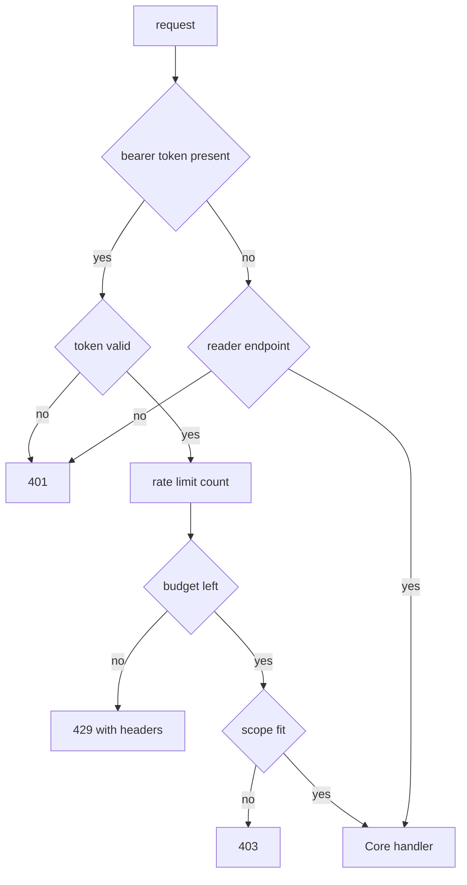

# HTTP API

## Purpose

Starforge exposes a JSON REST API under `/api/v1`. The crate `starforged-api` stays thin.
Handlers authenticate requests and delegate to `Core`. Permission checks and validation live in `Core`.
`crates/starforged/src/serve.rs` mounts the router with `nest`. Mount point: `/api/v1`.

## Scope

JSON routes under `/api/v1` sit in scope. Token auth, scopes, rate limits, and errors sit in scope.
OpenAPI generation sits in scope. HTML pages sit out of scope under [web and authentication](web-and-auth.md).
Git smart HTTP sits out of scope under [git hosting](git-hosting.md). CLI behavior sits out of scope under [CLI](cli.md).

The page lists endpoint groups without each route.

## How it works

### Router shape

`router` in `crates/starforged-api/src/lib.rs` registers every route. Unknown paths answer `404` through the fallback handler.
Each route maps method and path pairs to handlers. Rename middleware rewrites old repository names before fallback.

### Authentication and scopes

Clients send `Authorization: Bearer <token>`. The `token` scheme also works for compatibility.
Missing headers mean anonymous access on reads. `ApiAuth::reader` permits anonymous callers.
`ApiAuth::reader` still checks `repo:read` for tokens. `ApiAuth::require` demands one named scope.

Missing tokens answer `401`. Insufficient scopes answer `403` with the missing scope name.
Scope checks run before repository permission checks. Repository permission checks run inside `Core`.

| Scope | String | Effect |
|---|---|---|
| `RepoRead` | `repo:read` | Reads repository resources |
| `RepoWrite` | `repo:write` | Writes repository resources |
| `TrailWrite` | `trail:write` | Mutates Trails and changes |
| `SessionUpload` | `session:upload` | Uploads session segments |
| `SandboxRun` | `sandbox:run` | Runs sandboxes for a repository |

`admin` scope implies all other scopes. `repo:write` implies `repo:read`.
Read handlers mask non-readers as `404`. Admin audit also needs `user.is_admin`.

Non-admin audit callers receive `404`. Exceptions: `GET /openapi.json` needs no token.
All `POST /oauth/*` endpoints need no token.



### Rate limits

`rate_limit` middleware counts requests per valid token. Windows last 3600 seconds with fixed boundaries.
Requests without valid tokens skip counting. The hourly limit defaults to `5000`.
Configuration key: `[limits] api_per_token_per_hour`. A zero limit disables counting entirely.

The middleware logs only the token id. API `429` responses skip audit logging.
Limit windows reset at restart.

| Header | Meaning |
|---|---|
| `X-RateLimit-Limit` | Hourly budget per token |
| `X-RateLimit-Remaining` | Requests left in window |
| `X-RateLimit-Reset` | Window end as Unix seconds |
| `Retry-After` | Seconds before retry on `429` |

Rate headers appear on token-authenticated responses only. `429` responses add `Retry-After` with a minimum of 1 second.

### Errors

Every API error uses one JSON envelope.

```json
{"error": {"code": "not_found", "message": "not found", "details": null}}
```

`details` always carries `null`. OpenAPI declares `details` as a generic value.

| Status | Code | Client sees |
|---|---|---|
| `401` | `unauthenticated` | `a valid token is required` |
| `403` | `forbidden` | `permission denied` or scope message |
| `404` | `not_found` | `not found` |
| `400` | `bad_request` | Handler message |
| `422` | `invalid` | Handler message |
| `409` | `conflict` | Handler message |
| `413` | `payload_too_large` | Handler message |
| `429` | `rate_limited` | `rate limit exceeded` |
| `500` | `internal` | `internal error` |

The extractor answers `401` before scope checks. Unauthorized answers add `WWW-Authenticate: Bearer`.
Core `Forbidden` maps to `403` API responses. Core `EmailUnverified` maps to `403` with a verified email message.
Core `RateLimited` maps to `429` with a 60 second retry hint.

OAuth token errors use flat RFC 8628 bodies. A device-code `Invalid` error uses the standard envelope.

```json
{"error": "authorization_pending"}
```

Other OAuth errors include `slow_down`, `expired_token`, `access_denied`, `unsupported_grant_type`, and `invalid_grant`. Segment conflicts answer `409` with `{"hash": stored}`.
That shape differs from the envelope. The same slot with different bytes answers that conflict.

Identical re-uploads succeed with `200` instead. Missing segment hashes answer `400`.
Hash mismatches answer `422`. Oversize bodies answer `413`.

Rename middleware answers `301` after `404` reads. The `Location` header carries the new repository path.
Unknown routes answer `404` with the envelope. Internal errors hide the cause from clients.
Internal errors log the cause with `tracing::error!`.

### Pagination

The API uses four pagination styles. No `Link` headers exist.

| Style | Query | Response shape | Example |
|---|---|---|---|
| Keyset | `after` and `limit` | `trails` plus `next_after` | `GET /repos/{owner}/{repo}/trails?after=42&limit=50` |
| Keyset | `after` and `limit` | `entries` plus `next_after` | `GET /admin/audit?after=100&limit=100` |
| Offset | `page` and `per_page` | `results`, `page`, `per_page`, `has_more` | `GET /search/trails?q=rust&page=2&per_page=20` |
| Session pages | `page` | `events`, `page`, `pages`, `total` | `GET /repos/{owner}/{repo}/sessions/{ulid}/events?page=1` |
| Bare limit | `limit` | One array key only | `GET /repos/{owner}/{repo}/trails/{n}/changes/{k}/reviews?limit=30` |

Trail lists use keyset cursors with `after` and `limit`. Audit lists use keyset cursors with a default limit of `100`.
Audit limits clamp between `1` and `200`. Handlers fetch one extra row to test continuation.
Search lists use offset pages with `page` and `per_page`. Session events use pages with a default of `1`.

Bare limit lists cap one array with `limit` only. Bare limit keys include `changes`, `revisions`, `reviews`, and `threads`.
Invalid filter values answer `422`. Invalid `has_changes` or `has_sessions` values answer `422`.
JSON parse failures also answer `422`.

### Content types

| Use | Request `Content-Type` | Response `Content-Type` |
|---|---|---|
| JSON handlers | `application/json` | `application/json` |
| OAuth forms | `application/x-www-form-urlencoded` | `application/json` |
| Session meta and links | JSON bytes over `Bytes` | `application/json` |
| Segment upload and download | `application/octet-stream` | `application/octet-stream` |

Most handlers parse JSON bodies. OAuth handlers parse form bodies.
Segment upload arrives as raw bytes. Segment download returns exact stored bytes.
Session writes parse JSON from raw bytes by hand. Upload requests carry `X-Starforge-Blake3` with lowercase BLAKE3 hex.

The transport limit equals `max_segment_bytes` plus `8 KiB`. Configuration key: `[sessions] max_segment_bytes` with default `16 MiB`.
Handlers repeat the cap check after transport. Transport oversize answers `413` too.

Session endpoints carry `X-Robots-Tag: noindex`. Session search also carries `noindex`.
Trail search does not carry that header.

### OpenAPI

`ApiDoc` derives the OpenAPI 3.1 document. Every handler appears in the derive macro.
Utoipa derives schemas from handler annotations. `SecurityAddon` adds the `bearer_auth` scheme.

The title reads `Starforge API` and version reads `0.1.0`. `GET /openapi.json` serves the document without auth.
The handler builds the document once and clones it. `crates/starforged/tests/openapi.rs` scans `lib.rs` routes mechanically.

The test asserts equality between spec and router. The test also checks 3.1 shape, bearer scheme, and envelope references.
A second test matches optional security with `reader` handlers.

## Interfaces

### Endpoint groups

| Group | Representative paths | Scope needs |
|---|---|---|
| User | `GET /user` | Any valid token, with no scope check |
| Repositories | `GET /repos/{owner}/{repo}`, `POST /user/repos`, `PATCH /repos/{owner}/{repo}` | `repo:read` for reads, `repo:write` for writes |
| Collaborators | `GET /repos/{owner}/{repo}/collaborators`, `PUT /repos/{owner}/{repo}/collaborators/{handle}` | `repo:write` |
| Organizations | `POST /orgs`, `GET /orgs/{org}`, `PATCH /orgs/{org}`, `DELETE /orgs/{org}` | `repo:read` for reads, `repo:write` for writes |
| Teams | `GET /orgs/{org}/teams`, `PUT /orgs/{org}/teams/{team}/members/{handle}` | `repo:read` for reads, `repo:write` for writes |
| Trails | `GET /repos/{owner}/{repo}/trails`, `POST /repos/{owner}/{repo}/trails`, `PATCH /repos/{owner}/{repo}/trails/{n}` | `repo:read` for reads, `trail:write` for writes |
| Changes | `GET /repos/{owner}/{repo}/trails/{n}/changes`, `POST /repos/{owner}/{repo}/trails/{n}/changes`, `POST /repos/{owner}/{repo}/trails/{n}/changes/{k}/refresh`, `POST /repos/{owner}/{repo}/trails/{n}/changes/{k}/state` | `repo:read` for reads, `trail:write` for writes |
| Reviews | `GET /repos/{owner}/{repo}/trails/{n}/changes/{k}/reviews`, `POST /repos/{owner}/{repo}/trails/{n}/changes/{k}/reviews` | `repo:read` for reads, `trail:write` for writes |
| Notifications | `GET /user/notifications`, `POST /user/notifications/{id}/read`, `POST /user/notifications/read-all` | `repo:read` |
| Repository subscription | `GET /repos/{owner}/{repo}/subscription`, `PUT /repos/{owner}/{repo}/subscription`, `DELETE /repos/{owner}/{repo}/subscription` | `repo:read` |
| Trail subscription | `GET /repos/{owner}/{repo}/trails/{n}/subscription`, `PUT /repos/{owner}/{repo}/trails/{n}/subscription`, `DELETE /repos/{owner}/{repo}/trails/{n}/subscription` | `repo:read` |
| Statuses | `POST /repos/{owner}/{repo}/statuses/{sha}`, `GET /repos/{owner}/{repo}/statuses/{sha}` | `repo:read` for reads, `repo:write` for writes |
| Sessions | `PUT /repos/{owner}/{repo}/sessions/{ulid}`, `PUT /repos/{owner}/{repo}/sessions/{ulid}/segments/{n}`, `GET /repos/{owner}/{repo}/sessions/{ulid}/events` | `session:upload` for ingest, `repo:read` for reads, raw segment reads need the uploader or a site admin |
| Checkpoints | `GET /repos/{owner}/{repo}/sessions/{ulid}/checkpoints`, `GET /repos/{owner}/{repo}/sessions/{ulid}/checkpoints/{n}`, `PUT /repos/{owner}/{repo}/sessions/{ulid}/checkpoints/{n}` | `repo:read` for reads, `session:upload` for writes |
| Search | `GET /search/trails`, `GET /search/sessions`, `GET /repos/{owner}/{repo}/search/code` | `repo:read` |
| Webhooks | `GET /repos/{owner}/{repo}/hooks`, `POST /repos/{owner}/{repo}/hooks`, `GET /repos/{owner}/{repo}/hooks/{id}/deliveries` | `repo:write` |
| Gate rules | `GET /repos/{owner}/{repo}/gate-rules`, `POST /repos/{owner}/{repo}/gate-rules` | `repo:read` for reads, `repo:write` for writes |
| Tag protections | `GET /repos/{owner}/{repo}/tag-protections`, `POST /repos/{owner}/{repo}/tag-protections` | `repo:read` for reads, `repo:write` for writes |
| Archives | `GET /repos/{owner}/{repo}/archive/{*rest}` | `repo:read` |
| Releases | `GET /repos/{owner}/{repo}/releases`, `POST /repos/{owner}/{repo}/releases`, `GET /repos/{owner}/{repo}/releases/{*tag}`, `PATCH /repos/{owner}/{repo}/releases/{*tag}`, `DELETE /repos/{owner}/{repo}/releases/{*tag}` | `repo:read` for reads, `repo:write` for writes |
| Release assets | `PUT /repos/{owner}/{repo}/release-assets/{*rest}`, `GET /repos/{owner}/{repo}/release-assets/{*rest}`, `DELETE /repos/{owner}/{repo}/release-assets/{*rest}` | `repo:read` for reads, `repo:write` for writes |
| SSH keys | `GET /user/keys`, `POST /user/keys`, `GET /repos/{owner}/{repo}/keys` | `repo:read` for user keys, `repo:write` for deploy keys and writes |
| Admin audit | `GET /admin/audit` | `admin` plus site admin user |
| OAuth | `POST /oauth/device/code`, `POST /oauth/token`, `POST /oauth/revoke` | None |
| OpenAPI | `GET /openapi.json` | None |
| Runners | `POST /repos/{owner}/{repo}/runners/registration-token`, `POST /runners/register`, `GET /repos/{owner}/{repo}/runners`, `DELETE /runners/{id}` | `repo:write` for token, list, and revoke |
| Runner job protocol | `POST /runners/jobs/request`, `PATCH /runners/jobs/{id}/trace`, `POST /runners/jobs/{id}/heartbeat`, `PUT /runners/jobs/{id}` | Runner token `sfr_` |
| Job git credential | `POST /ci/jobs/{id}/git-credential` | Runner token `sfr_` with the fence header |
| Job artifacts | `POST /runners/jobs/{id}/artifacts/authorize`, `PUT /runners/jobs/{id}/artifacts/{*name}`, `GET /runners/jobs/{id}/artifacts/{*name}` | Runner token for authorize, artifact token or job token for upload and download |
| Job secrets | `POST /runners/jobs/{id}/secrets` | Runner token `sfr_` with the fence header |
| CI runs | `GET /repos/{owner}/{repo}/ci/runs`, `POST /repos/{owner}/{repo}/ci/runs`, `GET /repos/{owner}/{repo}/ci/runs/{id}`, `POST /repos/{owner}/{repo}/ci/runs/{id}/cancel` | `repo:read` for reads, `repo:write` for trigger and cancel |
| CI usage | `GET /repos/{owner}/{repo}/ci/usage` | `repo:read` at the API layer, at least Maintain in Core |
| Supplier links | `PUT /repos/{owner}/{repo}/ci/suppliers/{supplier}`, `DELETE /repos/{owner}/{repo}/ci/suppliers/{supplier}` | `repo:write` at the API layer, at least Admin in Core |
| CI secrets | `GET /repos/{owner}/{repo}/ci/secrets`, `POST /repos/{owner}/{repo}/ci/secrets`, `DELETE /repos/{owner}/{repo}/ci/secrets/{name}` | `repo:write` |
| Sandboxes | `POST /sandboxes`, `GET /sandboxes/runtimes`, `GET /sandboxes/{id}`, `DELETE /sandboxes/{id}` | `sandbox:run` token or job token |
| Sandbox operations | `POST /sandboxes/{id}/pause`, `POST /sandboxes/{id}/resume`, `POST /sandboxes/{id}/timeout`, `POST /sandboxes/{id}/exec` | `sandbox:run` token or job token |
| Sandbox files and ports | `GET /sandboxes/{id}/files`, `PUT /sandboxes/{id}/files`, `DELETE /sandboxes/{id}/files`, `GET /sandboxes/{id}/ports/{port}/url` | `sandbox:run` token or job token |

Organization member lists need a non-anonymous reader and answer `404` otherwise.
User SSH key reads need `repo:read`. Deploy key reads need `repo:write`. Success statuses include `200`, `201`, and `202`.
Deletes answer `204` without a body.

### Notification routes

The notification list honors `all` and `limit` query keys. The response stores one `notifications` array. Each object carries id, repository, Trail number, title, kind, reason, actor, absolute URL, creation time, and read flag. Creation time uses the trails API format.

`POST /user/notifications/{id}/read` marks one row read and returns the object. `POST /user/notifications/read-all` returns `marked` with the count. The repository subscription returns `mode` as `watching`, `ignoring`, or null. `DELETE` on the repository subscription answers `204`.

The Trail subscription returns `subscribed` as a boolean. `DELETE` on the Trail subscription resets to the participation default and answers `204`. Read [notifications](notifications.md) for recipient rules.

### CI and sandbox routes

CI tokens use three prefixes. `sfp_` names a personal access token.
`sfr_` names a runner token. `sfj_` names a job token. A fourth prefix, `sfa_`, names a one time artifact token.
Each extractor accepts one token kind and answers `401` for any other kind.

`RunnerAuth` accepts runner tokens on runner routes. `JobAuth` accepts job tokens on job routes.
`SessionAuth` accepts a personal access token or a job token on session routes.
`SandboxAuth` accepts a personal access token with `sandbox:run` or a job token on sandbox routes.
Runner and job traffic skips the personal access token rate limit count.

`POST /runners/jobs/request` long polls for at most 50 seconds for a claim.
It answers `201` with a claimed job or `204` with no job. The claim carries the job token and the fence.
The trace, heartbeat, finish, git credential, and job secrets routes require the fence header `X-Starforge-Fence`.
A stale fence answers `409`. A missing fence answers `422` with code `invalid`.

The lease deadline runs from claim time. Expired leases let another runner claim the job.
The trace route takes a `Content-Range` header and answers `416` on a range mismatch.
A canceled job makes the trace and finish routes answer the canceled state through the `Job-Status` header.

CI secrets resolve through `POST /runners/jobs/{id}/secrets` for egress header injection.
The response carries `Cache-Control: no-store`. The response never reaches logs or disk.
Secret values never enter the job environment. A `refs/for` run resolves no secrets unless the repository opts in.

CI usage reads one report per supplier for the current calendar month. Starforge meters native usage and limits it.
Starforge reads Depot usage from the Depot API and never enforces Depot limits.
Quota refusals answer `422` with code `invalid`. Sandbox quota refusals answer `429`.
### Archive and release routes

`GET /repos/{owner}/{repo}/archive/{*rest}` needs `repo:read` and streams one zip or tar.gz snapshot. `ArchiveFormat::parse` splits the rest into revision and format.

`GET /repos/{owner}/{repo}/releases` lists releases newest first. `POST /repos/{owner}/{repo}/releases` needs `repo:write` and answers `201`. The body carries tag, target, title, notes, draft, and prerelease. `GET /repos/{owner}/{repo}/releases/{*tag}` shows one release. `PATCH` edits title, notes, draft, and prerelease, and missing fields keep their values. `DELETE` answers `204` and keeps the git tag.

`PUT /repos/{owner}/{repo}/release-assets/{*rest}` needs `repo:write` and uploads raw bytes. The handler stores the request `Content-Type` header. Oversize bodies answer `413`. Success answers `201` with the asset JSON. `GET` returns the bytes with `Content-Disposition: attachment`. `DELETE` answers `204`.

Artifact upload takes raw bytes with a `X-Starforge-Sha256` header. Upload answers `201` and stores content in the blob store.
Artifact download answers `200` with raw bytes and a `X-Starforge-Blake3` header. Both routes send `Cache-Control: no-store`.


### JSON conventions
Success responses use JSON objects with stable keys. Creates answer `201` with the new resource.
Session meta creates answer `201` and updates answer `200`. Segment upload answers `200` for new and identical bytes. Session deletes answer `204` without a body.

A raw segment GET requires raw storage and the uploader or a site admin. A weaker reader gets `404`.

## Failure behavior

Missing tokens on writes answer `401`. Bad tokens on writes answer `401`.
Unknown routes answer `404` with `not_found`. Non-readers receive `404` instead of `403`.

Session ULIDs stay hidden from non-readers with `404`. Missing segment hashes answer `400`.
Hash mismatches answer `422`. Oversize segment bodies answer `413`.

Rate limits answer `429` with rate headers. The `Retry-After` value uses window end minus now.
Minimum `Retry-After` is `1` second. Ramp limits restart resets windows to empty.
Internal errors log and hide the cause.

## Verification

`crates/starforged/tests/openapi.rs` checks router coverage. The test scans route registrations in `lib.rs`.
The test compares spec paths with router paths. The test checks OpenAPI 3.1 version output.

The test checks `bearer_auth` security declarations. The test checks shared error envelope references.
`limits.rs` checks `429` responses with headers. `audit_completeness.rs` checks header absence when disabled.

`audit_completeness.rs` checks single count per request. Per-group tests cover behavior in `api.rs` and sibling files.
Core unit tests cover scope parsing and grants. Core unit tests cover fixed window counting.

## Related

- [Web and authentication](web-and-auth.md) for browser sign in
- [Sessions](sessions.md) for capture and ingest details
- [Trails](trails.md) for Trail and change resources
- [Webhooks](webhooks.md) for webhook delivery and retries
- [Search](search.md) for search query behavior
- [Configuration](configuration.md) for rate limit keys
- [CI and sandboxes](ci-and-sandboxes.md) for runner and sandbox design

<!-- ste-sources
crates/starforged-api/src/lib.rs
crates/starforged-api/src/auth.rs
crates/starforged-api/src/notifications.rs
crates/starforged-api/src/error.rs
crates/starforged-api/src/openapi.rs
crates/starforged-api/src/sessions.rs
crates/starforged-api/src/trails.rs
crates/starforged-api/src/changes.rs
crates/starforged-api/src/search.rs
crates/starforged-api/src/ci.rs
crates/starforged-api/src/ci_auth.rs
crates/starforged-api/src/sandboxes.rs
crates/starforged-core/src/tokens.rs
-->
