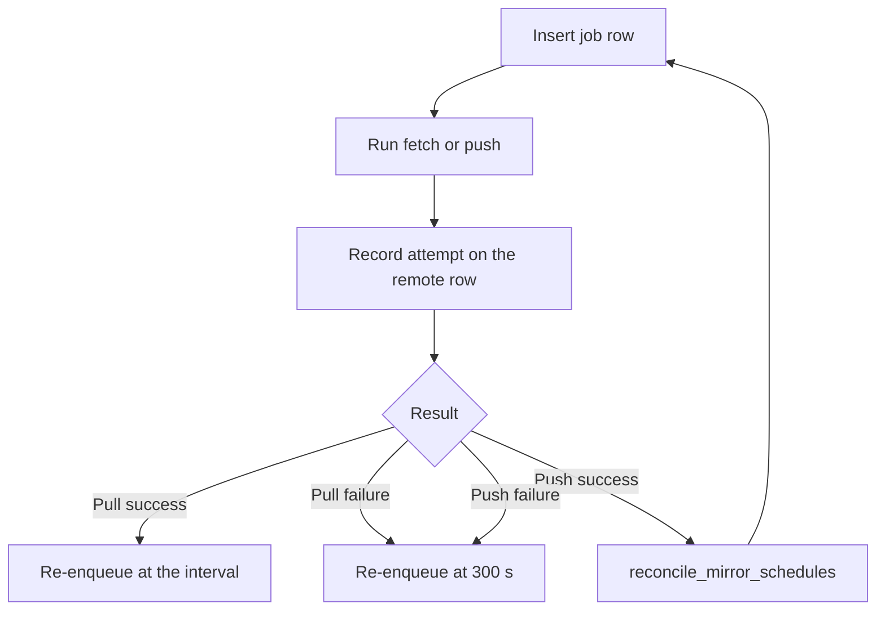

# Import and mirrors

<!-- ste-sources
crates/starforged-core/src/remotes.rs
crates/starforged-core/src/github.rs
crates/starforged-core/src/github/importer.rs
crates/starforged-core/src/github/status.rs
crates/starforged-api/src/repos.rs
crates/starforged-api/src/github_import.rs
crates/starforged-db/src/remotes.rs
crates/starforged-db/src/github_imports.rs
-->

## Purpose
This page explains git import, GitHub metadata import, pull mirrors, push mirrors, and outbound remote URLs. An operator reads this page to configure a mirror or debug a failed import. A developer reads this page to change the URL policy, the job flow, or the credential store. The administration guide gives the step-by-step procedures at [mirrors and import](../admin/mirrors-and-import.md).

## Scope

The page covers five mechanisms that copy refs or collaboration data from an outside source. One-time git import copies branches and tags once. GitHub metadata import copies issues and pull requests as Trails. Pull mirrors copy refs on a schedule. Push mirrors copy refs after each push. The URL policy guards every outbound fetch and push.

The page does not cover smart HTTP or SSH serving. Read [git hosting](git-hosting.md) for the inbound pack protocol. The page does not cover credential encryption in full. Read [security](security.md) for trust boundaries. The page does not list every configuration key. Read [configuration](configuration.md) for `github.api_url`, `remotes.allow_file_urls`, and `security.secret_key`.

## How it works

### Outbound URL policy
`Core::check_remote_url` in `crates/starforged-core/src/remotes.rs` guards every import and mirror URL. The policy runs at save time and again before each fetch or push. The check rejects a URL before git sees that URL. `check_url` accepts HTTPS and SSH. It also accepts scp-like `user@host:path` addresses.

It accepts HTTP only for a loopback host under the test-only flag `remotes.allow_file_urls`. It rejects `file://` URLs, local paths, `ext::` and `fd::` transports, and all other schemes. The test-only flag also admits loopback hosts, local paths, and `file://` URLs without credentials. Production never sets the flag. The check resolves the host and rejects non-global addresses.

The reject list covers private, loopback, link-local, unique-local, and multicast addresses. The list includes the metadata address `169.254.169.254`. The check reuses `webhooks::host_allowed` for these rules. `check_host` pins the first allowed address in a `PinnedRemote` value. Git then connects to the pinned address.

A DNS change between check and connection cannot redirect the transfer. The check strips a password from URL userinfo. The stored URL carries no password. Git receives credentials through environment entries only. Credentials never travel in argv or in the URL.

The check rejects any URL, user, or host that starts with a dash. A dash prefix can inject an SSH option such as `-oProxyCommand`. The check rejects whitespace and control characters in a URL, user, or host.

### One-time git import

A repository creation request carries an optional `import` body. The body holds a URL and an `auth` object. `ImportInput` and `ImportAuth` in `remotes.rs` define the body. HTTPS auth carries a username and a password or token. SSH auth asks the server to generate an ed25519 keypair.

`generate_import_key` creates the keypair and returns the public line for display. Starforge seals the private half at once. `create_import_for_repo` records one `import` row in `repo_remotes`. It sets `repos.import_state` to `pending`. The `ImportRepo` job runs `run_import`.

The job fetches only two refspecs. Each refspec carries a leading plus sign for force updates. The first refspec copies every branch into `refs/heads`. The second refspec copies every tag into `refs/tags`. Notes, pull refs, and Trail refs stay absent.

The job then sets `HEAD` to the remote default branch. `ls_remote_head` reads the symref and the code falls back to `main` with no symref. The import state moves through four values. The values are `pending`, `running`, `done`, and `failed`. `import_in_progress` reports true for `pending` and `running`.

`Core::git_rpc_env` then sets `STARFORGE_IMPORT_IN_PROGRESS` for the push hook. The hook in `crates/starforged/src/hook.rs` refuses every push during an import. An HTTPS import starts at once. An SSH import waits in `pending` until the operator starts it after the operator installs the deploy key upstream. `POST /repos/{owner}/{repo}/import/start` starts or retries the import.

`DELETE /repos/{owner}/{repo}/import` deletes the import row and resets the state to `none`. The repository then stays as a normal empty one.

### GitHub metadata import

`start_github_import` in `crates/starforged-core/src/github/importer.rs` starts one GitHub import. The caller needs repository admin permission. The repository must hold no Trail. An archived repository cannot start an import. The slug must take the shape `owner/repo`.

The token must not be empty. The function seals the token and stores it in `github_imports.token_sealed`. It sets the state to `pending` and enqueues `Job::ImportGithub`. The audit log records `repo.github_import_started` with the slug as detail.

`GithubClient::new` in `github.rs` builds the API client. The client sends the token as a bearer credential and never logs the token. The base URL is `github.api_url`, and the default is `https://api.github.com`. A GitHub Enterprise base can replace the default. The client allows HTTP only for a loopback host under the test flag.

The host passes the same SSRF rules as the webhook gate, and the client pins the address. The client caps each body at 10 MiB and times each request out after 30 s. The client follows no redirect. Pagination follows only `Link` next URLs on the same origin as `api_url`. `run_github_import` walks the source in ascending number order.

The walk imports issues first and skips pull requests in the issues listing. The walk imports pull requests next. Each object brings its comments, reviews, and review comments. A metadata call supplies `clone_url` for the pull-head fetch. Each object import lands in one database transaction.

A crash cannot leave a partial Trail. A resumed run reuses `github_id` values, so a resume never duplicates a Trail, comment, review, or review comment. An issue becomes a Trail with no changes. A pull request becomes a Trail with one imported change at `k = 1`.

The change holds the head name and the base name. The import fetches revision 1 for that change. The fetcher reads `refs/pull/<n>/head` from the `clone_url` remote through `ls_remote_ref` and `fetch_pull_head`. Revision 1 holds the fetched head SHA, the PR base SHA, and the merge base. Trail refs point at revision 1 under `refs/trails/<number>/changes/1/head` and `refs/trails/<number>/changes/1/rev/1`.

Only a ref that `ls-remote` proves absent takes the unfetchable path. That path closes the change and writes one note comment with a synthetic negative `github_id`. A fetch failure is fatal, so the retry ladder runs the import again. Trail state follows the GitHub object state. A merged pull request becomes a `merged` Trail.

A closed object becomes a `closed` Trail. Every other object becomes an `open` Trail. The imported change follows the pull state. A merged change records the method `merge` with the merge commit SHA when GitHub reports one. Trail numbers keep the GitHub numbers.

`insert_imported_trail_full` advances `trail_sequences` past the highest imported number. New Trails continue after that number. Gaps in the number space stay gaps.

| GitHub object | Starforge result |
|---|---|
| Issue | Trail with no changes |
| Pull request | Trail with one imported change |
| Number | `trails.number`, unchanged |
| Author | Local user by verified email, else placeholder |
| Labels | `trail_labels` rows by name |
| Assignees | `trail_assignees` rows for members |
| Issue comment | `trail_comments` row |
| Review | `reviews` row with a verdict |
| Review comment on the diff | `review_comments` row in a thread |
| Review comment off the diff | Quoted `trail_comments` row |

Author matching uses one rule. `resolve_author` matches the GitHub public email against local verified emails. A match sets `author_id`. A miss leaves `author_id` null and stores the handle in `imported_author`. The page renders the handle with the suffix `(imported)`.

Starforge escapes that suffix and never makes it a link to a local account. A deleted GitHub account carries neither value. Label matching normalizes each name through `normalize_label` and skips a name that Starforge rejects. Assignee matching resolves each handle the same way as an author. An assignee counts only when the matched user is a repository member.

The importer drops every other assignee and lists dropped handles in `github_imports.dropped_assignees`. Review verdicts map from three GitHub states. `APPROVED` becomes `approve`. `CHANGES_REQUESTED` becomes `request_changes`. `COMMENTED` becomes `comment`. The importer skips a `PENDING` review.

A review comment on the revision 1 diff becomes a thread. A reply appends to the parent thread. Every other review comment becomes a quoted Trail comment with path and line quoted. The importer writes one `trail.imported` timeline row per Trail. It dispatches no webhook for imported objects.

Imported bodies pass through the Markdown sanitizing pipeline. `GithubImportView` in `github/status.rs` reports the state, the cursor, five counts, dropped assignees, `has_token`, `failures`, and the redacted error. Those fields map one to one to `GithubImportRow`.

The importer does not import several GitHub data kinds. GitHub events and timeline records stay absent. Milestones and projects stay absent. Checks and gate rules stay absent. Agent sessions stay absent.

Commits arrive only through the pull-head fetch. The fetch covers the head SHA and its ancestors in the local repository. Review threads off the revision 1 diff become Trail comments and never become threads.

### Pull mirrors

`set_pull_mirror` configures one pull mirror per repository. The input carries a URL, auth, and `interval_secs`. The interval defaults to 3600 and must sit between 300 and 2592000. An archived repository refuses new configuration. `PUT /repos/{owner}/{repo}/mirror/pull` is the API entry point.

The pull remote is one `pull` row in `repo_remotes`. Enabling the row sets `repos.mirror` to true and queues one sync. Disabling restores pushes and merge and keeps the configuration. Deleting the row restores pushes.

`run_pull_mirror` performs one sync. The job holds the shared repository lock for fetch and ingest. The job rechecks the URL and opens the sealed credentials. It fetches with `IMPORT_REFSPECS` and `--prune`. The fetch timeout is 10 minutes.

`fetch_pull` snapshots refs before and after the fetch. A snapshot failure records an error and backs off. The job diffs the snapshots for branches and tags. Each moved branch runs the same ingest as post-receive. The ingest records revisions and mergeability.

`record_push` dispatches `push` webhooks with `sender` null, then `reschedule_pull_mirror` re-enqueues at the interval. The `PullMirror` job key `pull_mirror:<repo_id>` deduplicates the queue. The loop below shows the reschedule shape. A pull mirror reschedules after success and failure. A push mirror reschedules only after failure.

An enabled pull mirror refuses ordinary pushes and merges. `Core::protection_snapshot` sets `STARFORGE_MIRROR`. The hook refuses every branch, tag, and namespace update. A `refs/for` push still works for discussion. `merge_change` refuses with the message "this repository is a pull mirror".

Comments and reviews keep working on that repository. `POST /repos/{owner}/{repo}/mirror/pull/sync` queues an immediate sync.

### Push mirrors

`add_push_mirror` adds one push mirror. A repository holds at most 10 push mirrors. `insert_push_remote_capped` enforces the cap inside one transaction under a parent lock. `POST /repos/{owner}/{repo}/mirror/push` is the API entry point. Each push mirror is one `push` row in `repo_remotes`. An archived repository refuses new push mirrors.

`enqueue_push_mirrors` runs after each accepted heads or tags push, including deletions. A `refs/for` only push does not enqueue. The post-receive scan calls the function for the repository. The function enqueues one `PushMirror` job per enabled remote at now plus 30 s. The debounce window coalesces pushes inside the window. The job key `push_mirror:<remote_id>` deduplicates the queue.

`run_push_mirror` performs one push. The job holds the shared repository lock for the whole push. The job rechecks the URL and opens the sealed credentials. It pushes with `PUSH_MIRROR_REFSPECS` and `--prune`. The push timeout is 10 minutes. The refspecs copy branches and tags only.

Trail refs and `refs/for` refs never leave the repository. A failed push never blocks the repository push that triggered it. `record_attempt` stores the last result on the remote row. A success sets `last_success_at` and clears `last_error`.

A failure sets `last_error` to the redacted git stderr. `PushMirrorView` shows the attempt time, the success time, the error text, and `has_credentials`. `POST …/mirror/push/{id}/sync` queues an immediate run. `DELETE …/mirror/push/{id}` removes one remote. Queued jobs for a deleted remote become no-ops.

A successful run does not reschedule. The next accepted push debounces a fresh run.

### Credentials and encryption

`CredentialBox` in `crates/starforged-core/src/crypto.rs` seals every secret. The box derives its key from `security.secret_key` with HKDF-SHA256. The salt is `"starforge"` and the info string is `"mirror-credentials-v1"`. The seal uses XChaCha20-Poly1305. The stored value carries the prefix `x1:` and a base64 body.

Every seal uses a fresh nonce. A tampered value or a changed secret makes `open` fail. `Debug` output for the box renders only `CredentialBox(<redacted>)`. HTTPS credentials travel as a username plus a sealed password or token. SSH credentials travel as a sealed ed25519 private key.

No secret travels in a URL, argv, log line, or stored error. Git receives HTTPS credentials through an `http.extraHeader` environment entry. The SSH layer writes each private key to a `0600` temporary file for one command. The layer removes the file on success and on failure. The git layer redacts URL userinfo from stderr before any store or render.

Views carry only `has_credentials` and, for SSH, the public key. The GitHub token uses the same box. `start_github_import` seals the token at once. `run_github_import` opens the token only inside the job. The job clears the sealed token on completion and on final failure.

The status view reports only `has_token`. No error string in the GitHub client or the importer carries the token.

### Sessions and mirrors

Mirrors copy only named refs. The refspecs name branches and tags and nothing else. Session rows live in the database and segment bytes live in the blob store. Session data never enters a git object. A mirror can carry no session to another repository.

This holds for import, pull, and push mirrors alike. Trail refs and trace refs take the same path: push never sends them, and pull never fetches them.

## Interfaces

`remotes.rs` holds `check_remote_url`, `check_url`, `prepare_import`, `run_import`, `set_pull_mirror`, `run_pull_mirror`, `reschedule_pull_mirror`, `reconcile_mirror_schedules`, `add_push_mirror`, `enqueue_push_mirrors`, `run_push_mirror`, `reschedule_push_mirror`, and `generate_import_key`. `importer.rs` holds `start_github_import` and `run_github_import`. `status.rs` holds `GithubImportView` and `github_import_for`. `github.rs` holds `GithubClient::new`, `get_repository`, `list_issues`, `list_pulls`, `list_issue_comments`, `list_review_comments`, and `list_reviews`.

The tables below record the routes, the limits, and the storage shape. Storage lives in `repo_remotes`, `github_imports`, `trails.github_id`, `trail_comments.github_id`, `reviews.github_id`, and `review_comments.github_id`.

| Route | Purpose |
|---|---|
| `POST /api/v1/user/repos` | Create a repository with an `import` body |
| `POST /api/v1/orgs/{org}/repos` | Create an org repository with an `import` body |
| `GET /repos/{owner}/{repo}/import` | Show the import source and state |
| `POST /repos/{owner}/{repo}/import/start` | Start or retry the import |
| `DELETE /repos/{owner}/{repo}/import` | Delete the import source |
| `PUT /repos/{owner}/{repo}/mirror/pull` | Configure the pull mirror |
| `GET /repos/{owner}/{repo}/mirror/pull` | Show the pull mirror |
| `DELETE /repos/{owner}/{repo}/mirror/pull` | Delete the pull mirror |
| `POST /repos/{owner}/{repo}/mirror/pull/sync` | Queue an immediate sync |
| `POST /repos/{owner}/{repo}/mirror/pull/enabled` | Enable or disable the mirror |
| `POST /repos/{owner}/{repo}/mirror/push` | Add one push mirror |
| `GET /repos/{owner}/{repo}/mirror/push` | List push mirrors with results |
| `DELETE /repos/{owner}/{repo}/mirror/push/{id}` | Delete one push mirror |
| `POST /repos/{owner}/{repo}/mirror/push/{id}/sync` | Queue an immediate push |
| `POST /api/v1/repos/{owner}/{repo}/import/github` | Start a GitHub import |
| `GET /repos/{owner}/{repo}/import/github` | Show the GitHub import status |

| Limit | Value | Code |
|---|---|---|
| Import fetch timeout | 30 minutes | `IMPORT_FETCH_TIMEOUT` |
| Pull fetch timeout | 10 minutes | `PULL_MIRROR_FETCH_TIMEOUT` |
| Push timeout | 10 minutes | `PUSH_MIRROR_PUSH_TIMEOUT` |
| Minimum pull interval | 300 s, at most 30 days | `PULL_MIRROR_MIN_INTERVAL_SECS` |
| Pull failure backoff | 300 s | `reschedule_pull_mirror` |
| Push debounce | 30 s | `PUSH_MIRROR_DEBOUNCE_SECS` |
| Push failure backoff | 300 s | `PUSH_MIRROR_BACKOFF_SECS` |
| Push mirrors per repository | 10 | `PUSH_MIRROR_MAX` |
| GitHub request timeout | 30 s | `REQUEST_TIMEOUT` in `github.rs` |
| GitHub body cap | 10 MiB | `MAX_BODY_BYTES` in `github.rs` |
| Rate-limit re-enqueue cap | 1 h | `RATE_LIMIT_CAP_SECS` |
| GitHub failure cap | 5 | `MAX_FAILURES` |

| Field | Table | Meaning |
|---|---|---|
| `role` | `repo_remotes` | One of `import`, `pull`, `push` |
| `sealed_secret` | `repo_remotes` | Sealed credentials, never shown |
| `ssh_public_key` | `repo_remotes` | Public line for upstream install |
| `interval_secs` | `repo_remotes` | Pull schedule, default 3600 |
| `enabled` | `repo_remotes` | 1 lets the mirror run |
| `last_attempt_at` | `repo_remotes` | Last run start |
| `last_success_at` | `repo_remotes` | Last successful run |
| `last_error` | `repo_remotes` | Scrubbed error, empty on success |
| `mirror` | `repos` | True while a pull mirror runs |
| `import_state` | `repos` | `none`, `pending`, `running`, `done`, `failed` |
| `token_sealed` | `github_imports` | Sealed token, cleared at the end |

Mirror configuration needs maintain permission. An import start needs maintain permission. A GitHub import start needs admin permission. Readers can read every configuration and status. A caller with no read access gets `404`.

The import and mirror writes add audit rows. The audit actions are `repo.import`, `mirror.create`, `mirror.update`, `mirror.delete`, and `mirror.credentials_changed`.

## Failure behavior

A URL policy refusal fails the save with `Invalid`. The API answers `422`. The policy recheck at run time redacts URL userinfo from the stored error. A host that rebinds to a private address fails closed at that recheck. A stored seal that cannot open fails the run with a clear error. The import then ends in `failed` with the redacted message.

The run never panics. An operator repairs a failed import by entering fresh credentials and starting it again. A failed import fetch sets `import_state` to `failed`. The remote row keeps the redacted error in `last_error`. The operator retries with `POST …/import/start` or deletes the source with `DELETE …/import`.

A deleted row mid-fetch blocks every later state write. `set_import_state_if_remote` returns false and the run ends without a terminal write. A pull mirror failure records the error and re-enqueues at 300 s. The repository keeps running. A push mirror failure records the error and re-enqueues at 300 s. The failure never blocks the pusher.

An archived pull mirror pauses. `run_pull_mirror` records the pause text `repository is archived; mirror paused` in `last_error`. The job still reschedules at the normal interval. Unarchiving resumes syncing with no reconfiguration. An archived repository refuses mirror configuration and GitHub import starts with `Invalid`.

A pull-mirror sync-now request on an archived repository answers `422`. A push-mirror sync still queues. Push mirrors keep running on an archived repository. The archived repository still allows enable, disable, and delete actions. A rate limit stops a GitHub import without failure. The importer saves the cursor and sets the state to `rate_limited`.

The job re-enqueues at the reset time from `X-RateLimit-Reset` or `Retry-After`. A re-enqueue lands at most 1 h after the limit. Other errors count toward the cap of 5 failures. Below the cap, the job retry ladder re-enqueues the run. At the cap, the import ends in `failed`.

The row stores the redacted error. An unfetchable pull head is not a failure. The change closes and one note comment records the missing ref. A repository lifecycle change keeps mirrors consistent. `delete_repo` marks `deleted_at` and a purge later removes the directory.

Both mirror tables declare `ON DELETE CASCADE` from `repos`. A purge deletes remote rows and the GitHub import record. A soft delete keeps the rows, so a restore returns the mirrors intact. `reconcile_mirror_schedules` runs at worker start and from hourly cleanup.

The reconciler requeues every enabled pull and push mirror with idempotent dedupe keys. A worker stop between completion and rescheduling cannot silence a mirror.

## Verification

Execute each step and confirm the expected result.

- Run `python3 scripts/ste_check.py docs/technical/import-and-mirrors.md`.
- Confirm the checker reports 0 errors and 0 warnings.
- Run the GitHub import and mirror integration tests.
- Confirm each mapping row matches the importer code.
- Confirm each limit matches the constants in the core code.
- Confirm each route matches the API handlers.
- Create a pull mirror against a loopback URL with the test flag set.
- Sync at once and confirm revisions and push webhooks arrive.
- Add a push mirror to the repository.
- Push one branch and confirm one push runs after the debounce.
- Confirm the remote row shows a success time.
- Start a GitHub import against a small repository.
- Confirm Trails, comments, reviews, and numbers match GitHub.
- Confirm the sealed token is gone after completion.
- Change `security.secret_key` and rerun one mirror sync.
- Confirm the run fails with the unreadable-credentials error.
- Archive the repository and confirm the pause text lands on the row.

## Related

Read [repositories](repositories.md) for the repository lifecycle. Read [git hosting](git-hosting.md) for ref policy, push hooks, and the merge path. Read [Trails](trails.md) for the Trail, change, revision, review, and thread model that GitHub import writes. Read [security](security.md) for SSRF rules, credential sealing, and audit events. Read [configuration](configuration.md) for `github.api_url`, `remotes.allow_file_urls`, and `security.secret_key`. Read the [administration guide](../admin/mirrors-and-import.md) for the operator procedure for imports and mirrors.
