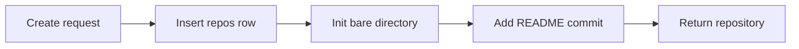

# Repositories

<!-- ste-sources
crates/starforged-core/src/repos.rs
crates/starforged-core/src/lib.rs
crates/starforged-core/src/permission.rs
crates/starforged-db/src/repos.rs
crates/starforged-db/src/redirects.rs
crates/starforged-web/src/moved.rs
crates/starforged-web/src/pages/repo_new.rs
crates/starforged-web/src/pages/repo_settings.rs
-->

## Purpose

This page explains the repository record, the disk directory, and the lifecycle of a repository. It covers creation, visibility, collaborators, rename, transfer, archive, soft delete, and purge. Read this page with [accounts and permissions](accounts-and-permissions.md). Read [git hosting](git-hosting.md) for transport and push policy.

## Scope

The repository row stores metadata in the database. The bare git directory stores refs and objects on disk. The core crate `starforged-core` coordinates both. The web layer and the API layer expose the core use cases. The database layer `starforged-db` stores the row in `repos`.

## How it works

### Repository row and disk path

One row in `repos` describes one repository. The row has a numeric `id`. The row also stores owner, name, description, visibility, and default branch. The table below lists each field.

| Field | Meaning |
|---|---|
| `id` | Numeric repository ID. The disk path derives from this value. |
| `owner_id` | Owning user or organization row in `owners`. |
| `name` | Repository name as the owner typed it. |
| `lower_name` | Lowercase form of `name`. The unique pair is `owner_id` plus `lower_name`. |
| `description` | Short description with a limit of 350 characters. |
| `visibility` | `public`, `internal`, or `private`. |
| `default_branch` | Branch name for new clones. Creation sets this value to `main`. |
| `created_at` | Creation time as Unix seconds. |
| `updated_at` | Last update time as Unix seconds. |
| `archived_at` | Archive time as Unix seconds. Null means live. |
| `deleted_at` | Soft delete time as Unix seconds. Null means live. |
| `mirror` | `1` marks a pull mirror. `0` marks a normal repository. |
| `import_state` | One of `none`, `pending`, `running`, `done`, or `failed`. |
| `refs_for_access` | `anyone_with_read` or `members` for `refs/for` pushes. |
| `redact_rules` | Contents of `.starforge/redact.toml` for session ingest. |

URLs use the shape `/{owner}/{repo}`. The owner segment carries the handle. The repository segment carries the name. A clone URL appends `.git` to the repository segment. A request path can end in `.git` and the code strips the suffix.

The disk path uses `Core::repo_path`. The path is `<repos_dir>/<id % 100, two digits>/<id>.git`. For example, repository `7` lives at `repos/07/7.git`. Repository `1234` lives at `repos/34/1234.git`. Init creates the `repos` directory under the data directory.

Rename and transfer change the row only. Neither operation moves the directory.

### Creation

`create_repo` creates one repository for the actor. `create_repo_with_import` adds an import body to the same flow. The actor owns the repository when the owner handle names the actor. The actor must hold the org owner role when the owner handle names an organization. A caller with no right to create under the owner gets `Forbidden`. A missing owner gets `NotFound`.

`validate::repo_name` checks the name. The name has 1 to 100 characters. The allowed characters are letters, digits, dot, underscore, and dash. The name must not equal `.` or `..`. The name must not end in `.git`. Names compare case-insensitively through `lower_name`.

A taken name gets `Conflict`. A taken name that belongs to a deleted repository gets a conflict message that mentions restore or purge. `checked_description` trims the description. The description has at most 350 characters. Creation always sets the default branch to `main`. Creation runs `init_bare` with branch `main`.

The directory init holds the shared repository lock. The lock stops a backup from copying a half-created tree. A failed init deletes the row and deletes the directory.

Creation offers three starting modes. An empty repository starts with no commit. A README repository adds `README.md` as the first commit on `main`. The README heading carries the name. The description follows the heading when the description is not empty. An import repository starts empty in state `pending`.

The import URL check runs before the row insert. A policy refusal gets `Invalid` with no repository left behind. The web form lives in `pages/repo_new.rs`. The API body lives in `starforged-api`.

### Visibility and permission resolution

`Visibility` in `permission.rs` defines three values. `public` gives implicit `Read` to every viewer. `internal` gives implicit `Read` to every signed-in viewer. `private` gives no implicit access. `grants_for` collects grant facts for one viewer and one repository. `effective` takes the highest grant.

Site admins, user owners, and org owners get `Admin`. The function then takes the highest of org base permission, team grants, and the collaborator grant. Read [accounts and permissions](accounts-and-permissions.md) for the full grant model.

A viewer with no effective permission gets `NotFound`. The answer reveals no existence. A signed-in viewer below a required level gets `Forbidden` through `require_repo`. An anonymous viewer below a required level gets `Unauthenticated`. Suspended users count as anonymous. `repos_of` lists only repositories the viewer can read.

`dashboard_repos` joins owned, collaborating, and org-member repositories.

### Collaborators and settings surface

The table `collaborators` stores direct per-repository grants. Each row pairs one `repo_id` with one `user_id` and one permission. Permissions are `read`, `triage`, `write`, `maintain`, and `admin`. The table below lists each level.

| Permission | Meaning |
|---|---|
| `read` | Read content and Trails. |
| `triage` | Triage Trails beyond `Read`. |
| `write` | Push branches and tags. |
| `maintain` | Change settings, protection, and mirrors. |
| `admin` | Change visibility, collaborators, and lifecycle. |

Only a repository admin manages collaborators. `set_collaborator` upserts one grant. The upsert replaces an existing grant for the same pair. `remove_collaborator` deletes one grant. The owner already holds `Admin`. Starforge rejects a collaborator row for the owner.

Unknown handles get `Invalid` on set and `NotFound` on remove. Each change writes one audit row. The web page lives in `pages/collaborators.rs`.

The settings page lives in `pages/repo_settings.rs`. Maintainers change description and default branch. Maintainers also change the `refs/for` access mode. Admins change visibility, rename, transfer, archive, and delete. The protection page lives in `pages/protection.rs`. The mirrors page lives in `pages/remotes.rs`.

Most settings actions write one audit row. Description and `refs/for` access changes write none.

### Rename redirects

`rename_repo` needs `Admin`. The function validates the new name. A same-name rename returns the repository unchanged. A rename runs inside one database transaction. The old name gains a row in `repo_redirects`. The row maps the old `owner_id` plus `lower_name` to the repository `id`.

A case-only rename adds no redirect. A redirect that holds the new name drops. `repos::insert` also drops a redirect that holds the new name. A new repository takes the old name over.

Middleware `moved::redirect_renamed` answers redirects. The middleware acts on `GET` and `HEAD` only. A page `404` triggers the lookup. An `info/refs` `401` also triggers the lookup. The lookup calls `moved_repo`. The function returns a repository only when the viewer can read the target.

The middleware answers `301` to the same path and query under the new name. The location preserves a `.git` suffix. A viewer who cannot read the target gets the original `404`.

Old clone and push URLs keep working. A `GET .../info/refs` request with an old name gets `301`. An authenticated `POST` receive-pack resolves the old name through `moved_repo` and pushes to the renamed repository. The server sends no redirect for the POST.

Redirects cascade when the repository row deletes. A purge ends old redirects for good.

### Transfer between owners

`transfer_repo` needs `Admin` on the source repository. The target must be the actor or an org the actor owns. A site admin gets no bypass here. The actor must also have the right to create under the target. An archived repository can transfer. A same-owner transfer returns unchanged.

A clash at the target gets `Invalid`. A gone target gets `NotFound`. The transfer runs in one transaction. The move locks both org rows in id order. The move records the old `<owner>/<name>` path in `repo_redirects`. A redirect that holds the new path stops.

Old org team links drop. Collaborator rows stay. Org ownership means the old org base permission and team grants stop. The new org base permission and team grants then apply. The disk directory stays at the same path. One `repo.transfer` audit row records the move.

### Archive

`archive_repo` and `unarchive_repo` need `Admin`. Archive sets `archived_at` to the current time. Unarchive clears the value. An archived repository stays readable. The git layer refuses receive-pack with `403` over HTTP. The SSH layer refuses the command before the hook runs.

Merges refuse with the same archive rule. `merge_change` requires a live repository. Gate rules refuse create, update, and delete. Tag protections and mirror configuration refuse saves. Push mirror adds refuse new mirrors.

Description, default branch, visibility, rename, transfer, and delete still work on an archived repository.

A pull mirror pauses on an archived repository. `run_pull_mirror` records `repository is archived; mirror paused` on the remote row. The job still reschedules at the normal interval. Unarchive resumes syncing with no reconfiguration.

Push mirrors keep running on an archived repository. The admin can still delete a push mirror and trigger a manual sync. Starforge has no per-mirror disable action.

Read [import and mirrors](import-and-mirrors.md) for mirror detail.

### Soft delete, restore, and purge

`delete_repo` needs `Admin`. The caller must type `<owner>/<name>` as confirmation. A wrong confirmation gets `Invalid`. Delete sets `deleted_at` to the current time. The repository then answers like a missing one. Lists exclude deleted rows.

`deleted_repos` lists rows inside the restore window. `RESTORE_SECS` equals 7 days. `restorable` checks `deleted_at > now - RESTORE_SECS`. The daily job `purge_deleted_repos` takes every row with `deleted_at <= now - RESTORE_SECS`.

`restore_repo` clears `deleted_at` inside the window. The actor needs `Admin` on the repository. Anyone else gets `NotFound`. Restore writes `repo.restore` audit and enqueues an index job. `purge_repo` removes the repository for good. The steps run in a crash-safe order.

Purge holds the exclusive repository lock. Purge moves the directory to `<tmp_dir>/purge-<id>.git`. Purge then deletes session rows through the shared delete path. Purge then deletes the `repos` row. Collaborators, redirects, Trails, and remotes cascade. Purge finally removes the parked directory.

One `repo.purge` audit row records the end.

### Default branch and first commit

Creation sets the default branch to `main`. The bare init uses `initial_commit` for the README mode. The commit author is the actor display name or handle. The commit email is the verified email or `<handle>@users.noreply.<host>`. `set_default_branch` needs `Maintain`. The branch must exist in the bare directory.

The function points `HEAD` at the branch with `set_head`. The function then updates the `default_branch` column. New clones check out that branch.

Branch and tag protection live elsewhere. Gate rules control direct pushes, force pushes, and deletes. Tag protections control tag create, move, and delete. The hook snapshot carries both rule sets at push time. Read [git hosting](git-hosting.md) for the hook and snapshot. Read [Trails](trails.md) for change review and gates.

### Repository flags

The column `refs_for_access` controls `refs/for` pushes. `anyone_with_read` lets any reader push changes. `members` lets only members push changes. The value defaults to `anyone_with_read` on insert. Maintain and above can change the value. The hook snapshot reads the value at spawn time.

The column `mirror` marks a pull mirror. Enabling a pull mirror sets `mirror` to `1`. Disabling keeps the remote row and restores pushes. Deleting the row also restores pushes. The column `import_state` tracks one-time import. The values are `none`, `pending`, `running`, `done`, and `failed`.

The hook sets `STARFORGE_IMPORT_IN_PROGRESS` for `pending` and `running`. The hook then refuses every push during the import. Read [import and mirrors](import-and-mirrors.md) for the import flow.

### Sessions per repository and deletion effects

Session rows carry `repo_id`. Sessions belong to one repository through a foreign key with cascade. `sessions_of_repo` lists sessions for one repository. Each session has segments with blob hashes. Blob rows track reference counts. `delete_session` returns segment rows for ref decrements.

Index documents drop through an index job. Purge deletes every session of the repository. `purge_repo` loops over batches from `sessions_of_repo`. Each batch calls `remove_session_rows` with audit action `session.purged`. The function drops segment rows, commit links, blob references, and index documents. Soft delete keeps sessions intact.

A restore returns sessions with the repository. Hard purge drops sessions, Trails, redirects, remotes, and the directory together.

## Interfaces

The routes below cover the repository lifecycle. API rows start with `/api/v1`. Web rows start with `/{owner}`.

| Route | Purpose |
|---|---|
| `POST /api/v1/user/repos` | Create a repository for the actor. |
| `POST /api/v1/orgs/{org}/repos` | Create a repository under an org. |
| `GET /api/v1/repos/{owner}/{repo}` | Show one repository. |
| `GET /{owner}` | List readable repositories of one owner on the web. |
| `PATCH /api/v1/repos/{owner}/{repo}` | Set `refs_for_access`. |
| `POST /api/v1/repos/{owner}/{repo}/transfer` | Move the repository to a new owner. |
| `PUT /api/v1/repos/{owner}/{repo}/collaborators/{handle}` | Set one collaborator grant. |
| `DELETE /api/v1/repos/{owner}/{repo}/collaborators/{handle}` | Remove one collaborator grant. |
| `POST /{owner}/{repo}/settings/rename` | Rename through the web settings page. |
| `POST /{owner}/{repo}/settings/transfer` | Transfer through the web settings page. |
| `POST /{owner}/{repo}/settings/archive` | Archive through the web settings page. |
| `POST /{owner}/{repo}/settings/unarchive` | Unarchive through the web settings page. |
| `POST /{owner}/{repo}/settings/delete` | Soft delete through the web settings page. |

`Core::create_repo` and `create_repo_with_import` create repositories. `Core::repo_for` and `require_repo` resolve access. `Core::rename_repo`, `transfer_repo`, `archive_repo`, `delete_repo`, and `restore_repo` cover lifecycle. `Core::purge_deleted_repos` and `purge_repo` cover deletion. `Core::moved_repo` resolves redirects.

`Core::repo_path` builds the disk path. The API handlers live in `starforged-api`.

## Failure behavior

Creation with a bad name gets `Invalid`. Creation with a taken name gets `Conflict`. Creation under another user gets `Forbidden`. Creation with a bad import URL gets `Invalid` before any write. A failed directory init deletes the row and the directory. No partial repository stays behind.

Rename with a taken name gets `Conflict` and changes nothing. Transfer with a clash at the target gets `Invalid`. Delete with a wrong confirmation gets `Invalid`. Restore outside the window gets `NotFound`. Purge of a restored repository stops at the still-deleted check. A purge failure reports the step in the error text.

A rerun finishes the purge. Archive refuses pushes with `403` at the HTTP layer. The SSH layer refuses the command. Mirror sync on an archived pull mirror records the pause text and reschedules. Reads stay open. Settings writes that refuse archives answer `422` in the web layer.

## Verification

Execute each step and confirm the expected result.

- Run `python3 scripts/ste_check.py docs/technical/repositories.md`.
- Confirm the checker reports 0 errors and 0 warnings.
- Create an empty repository and list rows in `repos`.
- Confirm the directory path follows the `id % 100` rule.
- Create a repository with a README and check the first commit.
- Confirm import state `pending` after an import creation.
- Rename the repository and confirm the redirect row exists.
- Confirm `GET` with the old name answers `301`.
- Confirm a push with the old name lands on the renamed repository.
- Transfer the repository to an org and confirm the redirect.
- Archive the repository and confirm push refusal.
- Delete the repository and restore it inside 7 days.
- Confirm purge deletes the directory, sessions, and redirects.

## Related

Read [accounts and permissions](accounts-and-permissions.md) for grant resolution. Read [git hosting](git-hosting.md) for transport and ref policy. Read [import and mirrors](import-and-mirrors.md) for import state and mirror flags. Read [Trails](trails.md) for change review on repository branches. Read [sessions](sessions.md) for session rows per repository.
