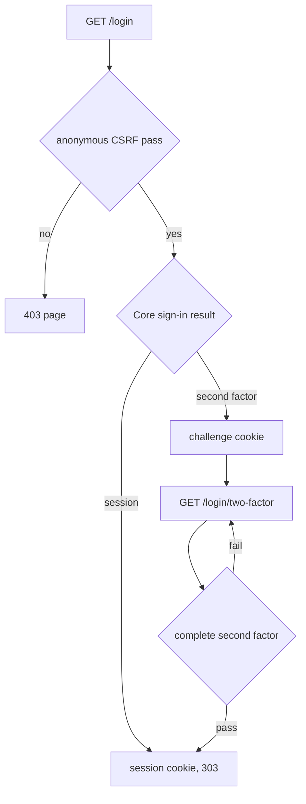

# Web and authentication

## Purpose

`starforged-web` renders HTML pages and git smart HTTP. Each handler calls `starforged_core::Core` for storage and rules.
`AppState` holds the core handle and public web settings. `WebSettings` holds `base_url`, `secure_cookies`, and `ssh_clone_base`.
Handlers return rendered templates or redirects.

## Scope

`crates/starforged-web/src/lib.rs` owns the page router and git router. `crates/starforged-web/templates/` holds about 80 Askama templates.
`starforged-core` owns password checks and session state. Git transport details sit in [git hosting](git-hosting.md).
The page excludes the API router under `/api/v1`. Procedures for account tasks sit in [user guide](../user/).

## How it works

### Router shape

`router` merges two routers in `crates/starforged-web/src/lib.rs`. `page_routes` owns page paths and static files.
`git_routes` owns smart HTTP paths under each repository path.

Mutating page actions use `POST` only. Static files serve at `/static/starforge.css`, `/static/highlight.css`, and `/static/session-viewer.js`.
Discovery data serves at `/.well-known/starforge.json`.

### Middleware order

Layer order puts rename redirects first and security headers second. The router runs after both layers.
`moved::redirect_renamed` answers `301` for old repository names. It only rewrites `GET` and `HEAD` responses with `404`.

It also rewrites `401` responses from `info/refs` paths. `security_headers` maps response headers with `or_insert`.
Handlers can set their own header and keep it. No global CSRF layer exists.
Each mutating handler checks CSRF itself.

### Security headers and CSP

The default headers cover four protections.

| Header | Value |
|---|---|
| `Content-Security-Policy` | `default-src 'self'; img-src 'self' data:; frame-ancestors 'none'; base-uri 'none'; form-action 'self'` |
| `X-Content-Type-Options` | `nosniff` |
| `Referrer-Policy` | `same-origin` |
| `X-Frame-Options` | `DENY` |

`STRICT_CSP` in `views.rs` tightens the default policy.

| Header | Value |
|---|---|
| `Content-Security-Policy` | `default-src 'none'; img-src 'self'; style-src 'self'; script-src 'self'; connect-src 'self'; frame-ancestors 'none'; base-uri 'none'; form-action 'self'` |

Handlers for blame, changes, session viewer, session download, and Trail pages set it. The policy has no nonce.
Pages use server-rendered forms only. Pages use no htmx.

English strings stay in templates without a Fluent catalog. The strict policy forbids inline scripts entirely.
Scripts serve only from this origin.

### Authentication extractors

| Extractor | Anonymous callers | Non-admin callers |
|---|---|---|
| `MaybeUser` | `None` | Session or `None` |
| `RequireUser` | `303` toward sign-in page | Session |
| `RequireAdmin` | `404` | `404` |

`MaybeUser` reads `sf_session` and resolves the web session. A missing cookie gives `None`.
`RequireUser` redirects anonymous browsers toward the sign-in page. The redirect uses `303` with a percent-encoded `next` path.

`RequireAdmin` answers `404` for anonymous and non-admin users. The admin pages stay invisible to other users.
Extractors use `Core::web_session` for cookie lookup.

### Web sessions and cookies

The session cookie holds an opaque random value. The database stores the matching row and CSRF token.
All web cookies set `HttpOnly` and `SameSite=Lax`. Cookies set `Path=/` for the whole site.
`Secure` follows `WebSettings::secure_cookies`.

| Cookie | Value | Lifetime |
|---|---|---|
| `sf_session` | Web session token | Session age from core |
| `sf_login_csrf` | Anonymous CSRF token | 1 hour |
| `sf_login_challenge` | Challenge cookie for second factor | 5 minutes |
| `sf_oidc_challenge` | OIDC challenge token | Challenge age from core |

CSRF tokens compare with constant time checks. `verify_csrf` rejects an empty expected token.
A missing `_csrf` field in `CsrfForm` deserializes as an empty string. A missing field in `LoginForm` or `TwoFactorForm` fails extraction with `422`.

Anonymous forms use a double-submit cookie.
`anonymous_csrf` reuses a live cookie or creates one. `verify_anonymous_csrf` compares the form field with the cookie.

`safe_next` accepts same-site absolute paths only. Unsafe values fall back to `/`.
The check blocks open redirects and header injection.

### Sign-in and second factor

A reader opens `GET /login` with an optional `next` value. `submit` checks anonymous CSRF before password checks.
`Core::login` receives handle, password, user agent, and address. Success sets `sf_session` and clears `sf_login_csrf`.
Success redirects with `303` to the safe `next` path. With TOTP enabled, password sign-in sets the challenge cookie.

`GET /login/two-factor` needs the challenge cookie. An empty challenge redirects back to `/login`.
`complete_second_factor` checks the TOTP code or recovery code. Five failed codes void the challenge.
Success sets `sf_session` and removes challenge and CSRF cookies. Bad codes answer `401` with the form again.

Wrong passwords answer `401`. Unverified email answers `403` with a resend form.
Rate limits answer `429`.

### OIDC and device approval

`GET /login/oidc` calls `oidc_begin` with sign-in intent. The handler redirects to the provider with a challenge cookie.
`GET /login/oidc/callback` needs cookie, code, and state. Missing inputs answer the generic failure page with `401`.
Provider error strings never reach the browser. Link intent needs a matching signed-in user.

`oidc_login` returns a session, a second factor challenge, or no account. No account answers `401` with instructions.
`GET /oauth/device` needs `RequireUser`. `POST /oauth/device/approve` checks signed-in CSRF first.

Valid decisions are `approve` and `deny` only. Other values answer `422`.
Approval calls `Core::approve_device_code` and shows a banner. Unknown codes answer `404`.

### Logout

`POST /logout` checks signed-in CSRF with `RequireUser`. Logout calls `Core::logout` and removes `sf_session`.
Logout redirects to `/`.

### Rendering and escaping

Askama templates escape values by default. `markdown::render` converts input with comrak first.
Raw HTML stays off in comrak options. The output passes through `ammonia::clean` next.
Cleaning strips scripts and `javascript:` links. `render_prose` also strips image elements.

Session prose drops images to stop IP leaks. `render_repo_document` rewrites relative links onto tree, blob, or raw routes.
It percent-decodes each segment before rewriting. It clamps dot and dot-dot segments at the repository root.
It blocks decoded slash smuggling. `plain` escapes five markup characters for preformatted text.

Syntax highlighting uses syntect with two-face sets. `highlight_lines` emits one balanced span set per line.
Files over `512 KiB` render as plain text. Lines over `5000` characters also render as plain text.

Parse failures also render as plain text. Highlighting runs on a blocking thread pool.
Styles serve at `/static/highlight.css` with light and dark themes.

### Git smart HTTP

Smart HTTP shares the page router. Routes handle `info/refs`, `git-upload-pack`, and `git-receive-pack`.
Basic auth uses a token as the password. The code ignores the username field.
Anonymous fetch of public repositories needs no credentials. Anonymous failures answer `401` so git prompts for credentials.

Authenticated failures answer `404` or `403`. Archived repositories answer `403` on push.
The router disables body limits for git routes. See [git hosting](git-hosting.md) for ref policy and hooks.

## Interfaces

### Route groups

| Group | Representative paths | Page modules |
|---|---|---|
| Dashboard and search | `/` and `/search` | `dashboard`, `search` |
| Accounts | `/login`, `/login/two-factor`, `/login/oidc`, `/join`, `/logout`, `/forgot`, `/reset/{token}`, `/verify/{token}` | `login`, `device`, `join`, `verify`, `password` |
| Personal settings | `/settings/profile`, `/settings/tokens`, `/settings/keys`, `/settings/identities` | `settings`, `settings_2fa`, `tokens`, `sshkeys`, `identities` |
| Site administration | `/admin/users`, `/admin/audit`, `/admin/quarantine`, `/admin/jobs`, `/admin/sandboxes`, `/admin/sandboxes/{id}/kill` | `admin` |
| Notifications | `/notifications`, `/notifications/{id}/open`, `/notifications/{id}/read`, `/notifications/read-all`, `/settings/notifications` | `notifications` |

| Organizations and teams | `/orgs/new`, `/orgs/{org}/members`, `/orgs/{org}/teams/{team}` | `orgs` |
| Repository creation | `/new`, `/{owner}/{repo}/import/start` | `repo_new` |
| Repository settings | `/{owner}/{repo}/settings`, `/{owner}/{repo}/settings/hooks`, `/{owner}/{repo}/settings/collaborators` | `repo_settings`, `webhooks`, `collaborators`, `protection`, `remotes`, `github_import` |
| Code browsing | `/{owner}/{repo}/tree/{*rest}`, `/{owner}/{repo}/blob/{*rest}`, `/{owner}/{repo}/raw/{*rest}` | `code`, `blame` |
| History and refs | `/{owner}/{repo}/commits`, `/{owner}/{repo}/commit/{id}`, `/{owner}/{repo}/branches`, `/{owner}/{repo}/compare/{*spec}` | `history`, `refs`, `compare` |
| Sessions | `/{owner}/{repo}/sessions`, `/{owner}/{repo}/sessions/{ulid}` | `sessions`, `session` |
| Trails and changes | `/{owner}/{repo}/trails`, `/{owner}/{repo}/trails/{number}`, `/{owner}/{repo}/trails/{number}/changes/{k}`, `POST /{owner}/{repo}/trails/{number}/changes/cross-repo` | `trails`, `changes` |
| CI runs and usage | `/{owner}/{repo}/ci`, `/{owner}/{repo}/ci/usage`, `/{owner}/{repo}/ci/{id}`, `/{owner}/{repo}/ci/{id}/logs`, `POST /{owner}/{repo}/ci/{id}/cancel` | `ci` |
| Archives | `/{owner}/{repo}/archive/{*rest}` | `releases` pages |
| Releases | `/{owner}/{repo}/releases`, `/{owner}/{repo}/releases/new`, `/{owner}/{repo}/releases/tag/{*tag}`, `/{owner}/{repo}/releases/edit/{*tag}`, `/{owner}/{repo}/releases/delete/{*tag}`, `/{owner}/{repo}/releases/assets/{*tag}`, `/{owner}/{repo}/releases/asset-delete/{*rest}`, `/{owner}/{repo}/releases/download/{*rest}` | `releases` pages |
| Owner profiles | `/{owner}` | `owner` |
| Static and discovery | `/static/starforge.css`, `/.well-known/starforge.json` | `well_known` |

The list groups about 150 routes. Representative paths hide the full route count.
A `message` module owns generic message pages.

### Notifications

`GET /notifications` lists unread rows. The query `?all=1` lists every row. `GET /notifications/{id}/open` marks one row read and answers `303` toward its URL. `POST /notifications/{id}/read` marks one row read. `POST /notifications/read-all` marks every row read.

`GET /settings/notifications` shows the email toggle and watched repositories. `POST /settings/notifications` stores the toggle. Each watched repository carries an unwatch control. `POST /{owner}/{repo}/watch` reads the form field `mode`. `POST /{owner}/{repo}/trails/{number}/subscription` reads the form field `subscribed`.

The navigation template shows a Notifications link with the unread count for signed in users. Read [notifications](notifications.md) for recipient rules and email.
### CI and sandbox pages

`/{owner}/{repo}/ci` lists CI runs, newest first. The runs page uses `MaybeUser`.
Anonymous readers see public repositories only. Core enforces Read and answers `404` for private repositories.
`/{owner}/{repo}/ci/{id}` shows one run with state, commit, logs, artifacts, and linked sessions.

The run page uses `MaybeUser` and Core enforces Read. The page escapes all runner supplied text.
`/{owner}/{repo}/ci/{id}/logs` shows full log text as plain text. The logs page uses `MaybeUser`.

It sends `Cache-Control: no-store, private`. Core enforces Read for logs.
`POST /{owner}/{repo}/ci/{id}/cancel` needs `RequireUser` and checks CSRF. Core enforces Write.

Success redirects with `303` to the run detail. A job of another repository answers `404`.
The cancel form shows for Write and for runs outside terminal states.

The usage page sends `Cache-Control: no-store`. Starforge meters native usage and limits it. Starforge reads Depot usage from Depot and never enforces Depot limits.

`/{owner}/{repo}/ci/usage` shows this month usage per supplier. It needs `RequireUser`. Core enforces at least Maintain.
The runs page links to usage for at least Maintain.

`/admin/sandboxes` lists every live and recently killed sandbox, newest first. The page needs `RequireAdmin`.
Anonymous and non admin callers receive `404`. `POST /admin/sandboxes/{id}/kill` kills one sandbox.
The kill action needs `RequireAdmin` and checks CSRF. Success redirects to `/admin/sandboxes`.
### Archive and release pages

`GET /{owner}/{repo}/archive/{*rest}` streams a zip or tar.gz snapshot. `ArchiveFormat::parse` splits the rest into revision and format. Core enforces read access.

`/{owner}/{repo}/releases` lists releases newest first. Drafts appear only for write access or higher. `/{owner}/{repo}/releases/new` shows the create form and `POST` creates the release. `/{owner}/{repo}/releases/tag/{*tag}` shows one release with its assets. `/{owner}/{repo}/releases/edit/{*tag}` shows the edit form and `POST` saves it. `POST /{owner}/{repo}/releases/delete/{*tag}` deletes one release and keeps the git tag.

`POST /{owner}/{repo}/releases/assets/{*tag}` uploads one asset from the multipart field `asset` with the field `_csrf`. `POST /{owner}/{repo}/releases/asset-delete/{*rest}` deletes one asset. `GET /{owner}/{repo}/releases/download/{*rest}` downloads one asset. The `{*rest}` split uses the last slash, because tags can contain a slash and asset names never can.

## Failure behavior

`WebError` variants render `error.html`. Handler-local auth and device errors render their own form or message page.

| Variant | Status | Reader sees |
|---|---|---|
| `NotFound` | `404` | `That page does not exist, or you do not have access to it.` |
| `Forbidden` | `403` | `You do not have permission to do that.` |
| `BadRequest` | `400` | `Invalid request` plus handler message |
| `Unprocessable` | `422` | `Invalid request` plus handler message |
| `TooManyRequests` | `429` | `Too many requests. Please wait and try again.` |
| `Internal` | `500` | `Something went wrong; the error was logged.` |

Internal errors log the cause with `tracing::error!`. CSRF failures answer `403` with the forbidden page.
Git errors answer plain text without the HTML page. Git unauthorized answers `401` with `Basic realm="Starforge"`.

Git forbidden and archived answer `403`. Git missing repositories answer `404`.
Core limits sign-in attempts per IP per minute and per account per hour. OIDC sign-in shares both limits. Each limit is configurable, and zero disables it.

Page form bodies get the Axum default 2 MiB body limit. Only git routes disable that limit. This crate configures no other page body limit.

## Verification

`auth.rs` unit tests cover safe redirect paths. `auth.rs` unit tests cover CSRF exact match.
`auth.rs` unit tests cover empty token refusal. `auth.rs` unit tests cover anonymous cookie reuse.

`markdown.rs` tests cover script removal and image stripping. `markdown.rs` tests cover link rewriting and dot-dot clamping.
`highlight.rs` tests cover escaping, spans, and size limits. `highlight.rs` tests cover light and dark stylesheets.

Integration tests in `crates/starforged/tests/web_*.rs` drive these routes in process. Unit tests in this crate cover auth, markdown, and highlight helpers.

## Related

- [Git hosting](git-hosting.md) for smart HTTP and SSH
- [HTTP API](http-api.md) for token-based API access
- [Sessions](sessions.md) for session viewing and capture
- [Trails](trails.md) for Trail pages and change pages
- [Accounts and permissions](accounts-and-permissions.md) for identities and grants
- [Security](security.md) for trust boundaries and abuse controls
- [User guide](../user/) for account procedures
- [CI and sandboxes](ci-and-sandboxes.md) for runner and sandbox design

<!-- ste-sources
crates/starforged-web/src/lib.rs
crates/starforged-web/src/auth.rs
crates/starforged-web/src/error.rs
crates/starforged-web/src/githttp.rs
crates/starforged-web/src/markdown.rs
crates/starforged-web/src/highlight.rs
crates/starforged-web/src/views.rs
crates/starforged-web/src/pages/mod.rs
crates/starforged-web/src/pages/ci.rs
crates/starforged-web/src/pages/admin.rs
crates/starforged-web/src/pages/notifications.rs
-->
