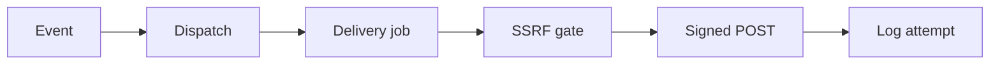

# Webhooks

## Purpose

Webhooks send signed repository events to an external URL. Each delivery posts one JSON envelope over HTTP. The worker retries failed deliveries on a fixed ladder.

Fan-out never blocks a caller. `dispatch_event` enqueues jobs and swallows faults. Delivery always runs on a worker, never inline in a request.

## Scope

This page covers subscriptions, secrets, signatures, and delivery in `crates/starforged-core/src/webhooks.rs`. It covers the `ci` event subject in `crates/starforged-core/src/ci.rs`. It covers the retry ladder in `crates/starforged-core/src/jobs.rs`. It covers HTTP routes in `crates/starforged-api/src/webhooks.rs`.

Read [http-api.md](http-api.md) for error envelopes and pagination. Read [security.md](security.md) for permission and abuse rules.

## Design

`EVENT_TYPES` lists six event names. The code emits all six events. Each hook subscribes to a subset. An empty subscription means all events.

| Event | Actions | Subject keys |
|---|---|---|
| `push` | None, None | `ref`, `before`, `after`, `created`, `deleted`, `pusher` |
| `trail` | `opened`, `ready`, `merged`, `closed`, `updated` | `number`, `title`, `state`, `ready`, `author`, `url`, `change` |
| `review` | `submitted`, `dismissed` | `id`, `trail`, `change`, `revision`, `verdict`, `state`, `author`, `body` |
| `check` | None, None | `sha`, `context`, `state`, `target_url`, `description`, `creator` |
| `session` | `uploaded`, `quarantined`, `published` | `ulid`, `uploader`, `agent`, `lifecycle_state`, `quarantine_state`, `visibility` |
| `ci` | `queued`, `started`, `finished`, `canceled` | `ci_job_id`, `job_name`, `commit_sha`, `state`, `runner_id`, `exit_code`, `created_by` |

`push` fires per branch or tag update. Only `refs/heads/*` and `refs/tags/*` qualify. `refs/for/*` proposals never emit `push`.

`trail` carries a `cause` with action `updated`. Causes include `edited`, `labeled`, `assigned`, and `session_linked`. The subject adds `change` with `k` and `revision` when one change caused the event.

`review` with `dismissed` fires on explicit dismissal. It also fires when a new revision lands. The automatic dismissal carries `sender: null`.

`ci` carries run identity for one CI job. `emit_ci_event` in `crates/starforged-core/src/ci.rs` builds the subject. Action `queued` fires at queue time. Action `started` fires at claim time.

Action `finished` fires at a terminal result. Action `canceled` fires at cancel time. Checks that a CI job submits carry `ci_job_id` in the subject.
`session` subjects carry identifiers and state only. Titles, reasons, prompts, and transcripts never enter a payload. `session_subject` enforces this rule in code.

Every envelope carries seven fixed fields. The subject sits under the key that names the event.

| Field | Content |
|---|---|
| `event` | One of `EVENT_TYPES` |
| `action` | String or `null` |
| `cause` | String or `null` |
| `at` | RFC 3339 UTC time |
| `repository` | `owner`, `name`, `full_name`, `url` |
| `sender` | Object with `handle`, or `null` |
| event name | The subject object |

`HookEvent` carries event, action, cause, sender, and subject. `dispatch_trail_event` builds the Trail subject. `dispatch_session_event` builds the session subject.

`classify_subscription` parses stored cell values. `Subscription::All` sends every event. `Subscription::Set` sends listed events only. `Subscription::Invalid` sends nothing.

Creation validates URLs and event names. URLs must hold 1 to 2000 bytes. Only `https` passes, with HTTP allowed for loopback hosts. Unknown event names answer `422` on create.

`create_webhook` mints a 32-byte hex secret. The API returns the plaintext once, in the `201` body. `WebhookDto` never carries the secret. Lists carry `has_secret` only.

The server seals secrets at rest. `seal_secret` encrypts with ChaCha20-Poly1305. The stored form is `v1:<base64(nonce|ciphertext)>` with a 12-byte nonce. The key is `config.webhook_key`.

`deliver_webhook` signs exact payload bytes. `hmac_sha256_hex` computes HMAC-SHA256 with `ring`. The signature header carries `sha256=<hex>`.

| Header | Value |
|---|---|
| `Content-Type` | `application/json` |
| `User-Agent` | `starforged/<version>` |
| `X-Starforge-Event` | Event name |
| `X-Starforge-Delivery` | Job identifier |
| `X-Starforge-Signature-256` | `sha256=<hex>` |

`X-Starforge-Delivery` stays stable across retries. Each redelivery mints a new identifier. A null sender means system-originated action.

`resolve_target` runs at delivery time. `host_allowed` accepts globally reachable addresses only. Loopback, private, link-local, and multicast ranges fail closed. IPv4-mapped IPv6 forms unwrap before checks.

The client pins the checked address. It never re-resolves the hostname. Redirects never follow. `DELIVERY_TIMEOUT` allows 10 seconds per attempt. `MAX_BODY_BYTES` caps bodies at 64 KiB.

| Attempt | Delay after failure |
|---|---|
| 1 | 60 s |
| 2 | 300 s |
| 3 | 1800 s |
| 4 | 7200 s |
| 5 | Terminal |

`MAX_ATTEMPTS` equals 5. `LEASE_SECS` equals 600. `retry_delay` returns `None` after five attempts. HTTP errors and transport errors enter the ladder.

Corrupt secrets end delivery at once. SSRF denials end delivery at once. Terminal outcomes record `last_status` and `last_error`. Missing or disabled hooks complete silently with no log row.

Each attempt writes one delivery row. `record_attempt` refreshes hook result fields. The hourly pass prunes delivery rows older than 30 days. A client cannot list or redeliver them. Terminal failures write `webhook.failed` timeline and audit rows.

| Logged field | Cap |
|---|---|
| Response body | 16 KiB |
| Response headers | 50 |
| One header value | 1 KiB |
| List limit | 1 to 100, default 20 |

`redeliver` replays stored payload bytes. The new delivery signs with the current secret. New rows carry `redelivery = 1`. The route needs an active hook and ≥ `Maintain`.

## Interfaces

`Core::create_webhook` seals and audits a new hook. `Core::delete_webhook` removes one hook. `Core::set_webhook_active` flips the active flag. `Core::list_webhooks` returns hooks without secrets.

`Core::list_deliveries` returns attempts newest first. `Core::get_delivery` returns one attempt with request and response. `Core::redeliver` returns the new delivery identifier.

| Route | Purpose |
|---|---|
| `GET /repos/{owner}/{repo}/hooks` | List hooks |
| `POST /repos/{owner}/{repo}/hooks` | Create hook |
| `PATCH /repos/{owner}/{repo}/hooks/{id}` | Enable or disable hook |
| `DELETE /repos/{owner}/{repo}/hooks/{id}` | Delete hook |
| `GET /repos/{owner}/{repo}/hooks/{id}/deliveries` | List attempts |
| `GET /repos/{owner}/{repo}/hooks/{id}/deliveries/{row}` | Show one attempt |
| `POST /repos/{owner}/{repo}/hooks/{id}/deliveries/{row}/redeliver` | Replay one attempt |

API routes need `Scope::RepoWrite`. `Core` then enforces `Maintain`. Settings pages render through `webhooks.html` and `webhook_delivery.html`.

## Failure behavior

Fan-out faults only log warnings. `dispatch_event` never fails the caller. A failed enqueue logs and moves on.

Delivery logs every outcome. Success, HTTP error, transport error, SSRF denial, and corrupt secret each write one row. Error text never contains the secret or signature.

Non-2xx statuses enter the retry ladder. Transport failures enter the ladder. Each retry reuses the same delivery identifier and payload.

An invalid stored subscription receives nothing. The DTO reports `subscription_invalid: true`. Operators must recreate the hook.

Archived repositories refuse new hooks. Redelivery refuses archived repositories. Redelivery refuses inactive hooks. Both answers carry `Invalid`.

## Verification

Unit tests live in `crates/starforged-core/src/webhooks.rs`. Integration tests live in `crates/starforged/tests/webhooks.rs`. Tests cover signing, SSRF denial, and redelivery.

Run `cargo test -p starforged-core webhooks` for unit tests. Run `cargo test -p starforged --test webhooks` for integration tests. Seeded harnesses allow loopback receivers in tests only.

## Related

Read [http-api.md](http-api.md) for route conventions and error shape. Read [security.md](security.md) for trust boundaries and secret handling.

Read [docs/user/api-and-webhooks.md](../user/api-and-webhooks.md) for receiver setup and signature checks.

<!-- ste-sources
crates/starforged-core/src/ci.rs
crates/starforged-core/src/webhooks.rs
crates/starforged-core/src/jobs.rs
crates/starforged-api/src/webhooks.rs
crates/starforged-web/templates/webhooks.html
crates/starforged-web/templates/webhook_delivery.html
-->
